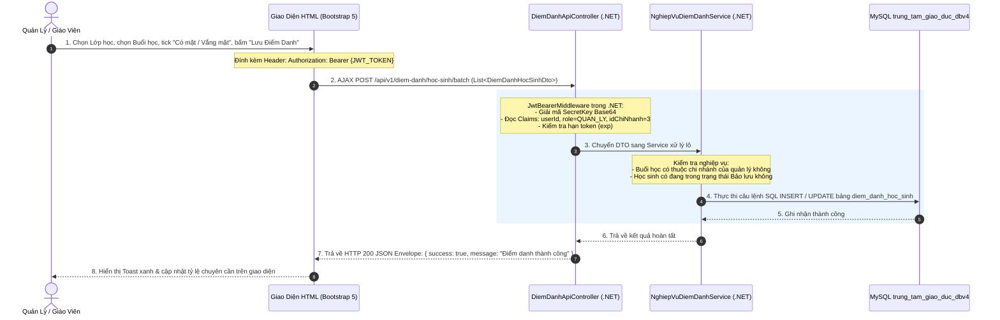

# ÁNH XẠ KIẾN TRÚC VÀ LUỒNG DỮ LIỆU TỪ JAVA SPRING BOOT SANG .NET

> **Mục tiêu**: Hướng dẫn chi tiết phương pháp chuyển đổi (map) toàn bộ hệ thống Backend **Quản lý Trung tâm Giáo dục** từ **Java (Spring Boot)** sang **.NET (C#) Web API**, đảm bảo tương thích 100% với Cơ sở dữ liệu MySQL `trung_tam_giao_duc_dbv4` và cơ chế bảo mật **JWT Token**.

---

## 1. MA TRẬN CHUYỂN ĐỔI ANNOTATION & THÀNH PHẦN (JAVA VS .NET)

### 1.1. Tầng Controller & Định tuyến Web API
Tuân thủ nghiêm ngặt quy định tại [`QUY_TAC_ANH_XA_REQUEST_CONTROLLER.md`](file:///c:/D/btlwebtrentruong/backend/src/main/java/com/example/project/controller/QUY_TAC_ANH_XA_REQUEST_CONTROLLER.md):

| Chức năng | Trong Java Spring Boot (`backend/`) | Trong .NET Web API (`dotnet_backend/`) | Ghi chú & Quy tắc xử lý |
|:---|:---|:---|:---|
| **Đánh dấu API Controller** | `@RestController` | `[ApiController]` & Kế thừa `ControllerBase` | Tự động kiểm tra Model State và trả về định dạng JSON. |
| **Định tuyến URL cơ sở** | `@RequestMapping("/api/v1/hoc-sinh")` | `[Route("api/v1/[controller]")]` hoặc `[Route("api/v1/hoc-sinh")]` | Đồng bộ chính xác URI endpoint để Front-end không cần sửa code. |
| **Phương thức HTTP** | `@GetMapping`, `@PostMapping`, `@PutMapping`, `@DeleteMapping` | `[HttpGet]`, `[HttpPost]`, `[HttpPut]`, `[HttpDelete]` | Giữ nguyên quy ước RESTful API. |
| **Nhận JSON Body** | `@RequestBody @Valid HocSinhDto dto` | `[FromBody] HocSinhDto dto` | Tự động parse payload JSON từ Client sang Object Model. |
| **Nhận biến trên URL** | `@PathVariable Integer idHs` | `[FromRoute] int idHs` | Truy vấn theo ID định danh tài nguyên. |
| **Nhận Query String / Filter**| `@RequestParam String keyword`, `HocSinhFilterDto filter` | `[FromQuery] HocSinhFilterDto filter` | Gom từ 3 tham số lọc trở lên thành Object Model Filter. |
| **Bảo vệ bằng JWT** | `@PreAuthorize("hasRole('ADMIN')")` | `[Authorize(Roles = "ROLE_ADMIN")]` | Kiểm tra quyền truy cập thông qua Claims trong JWT. |
| **Định dạng dữ liệu trả về** | `ApiResponse<T>` | `ApiResponse<T>` (nằm trong `dotnet_backend/Common/ApiResponse.cs`) | Chuẩn hóa Envelope `{ success, message, data, statusCode, errors }`. |

### 1.2. Tầng Entity & Ánh xạ Database MySQL
Cả 2 hệ thống cùng trỏ vào một cơ sở dữ liệu MySQL `trung_tam_giao_duc_dbv4`:

| Khái niệm ORM | Trong Java (JPA / Hibernate) | Trong .NET (Entity Framework Core) | Mẫu code chuyển đổi |
|:---|:---|:---|:---|
| **Khai báo bảng** | `@Entity @Table(name = "hoc_sinh")` | `[Table("hoc_sinh")] public class HocSinh` | Ánh xạ trực tiếp tên bảng trong MySQL. |
| **Khóa chính tự tăng** | `@Id @GeneratedValue(strategy = GenerationType.IDENTITY) @Column(name = "id_hs")` | `[Key] [Column("id_hs")] [DatabaseGenerated(DatabaseGeneratedOption.Identity)] public int IdHs { get; set; }` | Khóa chính tự động tăng trong MySQL. |
| **Tên cột & Kiểu dữ liệu** | `@Column(name = "ho_ten", nullable = false)` | `[Column("ho_ten")] [Required] public string HoTen { get; set; } = string.Empty;` | Ánh xạ tên cột snake_case sang thuộc tính PascalCase. |
| **Quan hệ nhiều - một** | `@ManyToOne @JoinColumn(name = "id_cn") private ChiNhanh chiNhanh;` | `[ForeignKey("IdCn")] public virtual ChiNhanh? ChiNhanh { get; set; }` | Navigation Property trong EF Core. |
| **Quan hệ một - nhiều** | `@OneToMany(mappedBy = "hocSinh") private List<DiemDanhHocSinh> ds;` | `public virtual ICollection<DiemDanhHocSinh> DiemDanhs { get; set; } = new List<DiemDanhHocSinh>();` | Liên kết ngược trong EF Core. |

---

## 2. ĐỒNG BỘ BẢO MẬT JWT GIỮA JAVA VÀ .NET (INTEROPERABILITY)

Điểm đặc biệt quan trọng: **Token sinh ra từ Java Backend có thể được giải mã và xác thực bởi .NET Backend, và ngược lại**. Cả hai dùng chung các tham số sau:

### 2.1. Cấu hình bảo mật dùng chung
- **Thuật toán ký**: `HMAC-SHA256` (HS256).
- **Khóa bí mật (Base64)**:
  `dGhpcy1pcy1hLXNlY3JldC1rZXktZm9yLWp3dC10b2tlbi1nZW5lcmF0aW9uLXdpdGgtc3VmZmljaWVudC1sZW5ndGgtMjU2LWJpdHM=`
- **Issuer (Nhà phát hành)**: `quanlytrungtam-auth-service`
- **Thời hạn Access Token**: 15 phút (900.000 ms).
- **Thời hạn Refresh Token**: 7 ngày (lưu trong HttpOnly Cookie).

### 2.2. Cấu trúc Claims trong Token Payload:
```json
{
  "sub": "12",
  "roles": "ROLE_QUAN_LY",
  "roleId": "2",
  "idDoanhNghiep": "1",
  "idChiNhanh": "3",
  "quyenHan": ["XEM_HOC_SINH", "DIEM_DANH", "THU_HOC_PHI"],
  "jti": "e674b01e-45fa-4c4b-b0b2-4d2d4d82b4a1",
  "iss": "quanlytrungtam-auth-service",
  "exp": 1740000000
}
```

Trong .NET, `dotnet_backend/Security/JwtProvider.cs` đã được lập trình để tạo ra và đọc chính xác các Claim này, giúp đảm bảo tương thích 100%.

---

## 3. SƠ ĐỒ LUỒNG ĐI DỮ LIỆU ĐỒNG BỘ (2-WAY DATA FLOW)

Ví dụ nghiệp vụ thực tế: **Quản lý thực hiện Điểm danh học sinh trong buổi học**:



---

## 4. BẢNG ÁNH XẠ CÁC SERVICE CHÍNH TỪ JAVA SANG .NET

| Phân hệ nghiệp vụ | Java Service (`backend/`) | .NET Service tương ứng (`dotnet_backend/`) | Vai trò nghiệp vụ |
|:---|:---|:---|:---|
| **Xác thực & Phiên** | `TaiKhoanService.java` | `ITaiKhoanService` / `TaiKhoanService.cs` | Đăng nhập, đổi mật khẩu, Refresh Token, phân quyền. |
| **Hồ sơ Học sinh 360°**| `HocSinhPhuHuynhService.java` | `IHocSinhService` / `HocSinhService.cs` | Quản lý học sinh, phụ huynh, liên kết gia đình. |
| **Giáo viên & Chuyên môn**| `GiaoVienHoSoService.java` | `IGiaoVienService` / `GiaoVienService.cs` | Bằng cấp, chi nhánh công tác, lịch dạy. |
| **Đào tạo & Lớp học** | `TraCuuLopHocService.java` | `ILopHocService` / `LopHocService.cs` | Môn học, khóa học, lớp học, phòng học, lịch học cố định. |
| **Nghiệp vụ Điểm danh** | `NghiepVuDiemDanhService.java` | `IDiemDanhService` / `DiemDanhService.cs` | Điểm danh học sinh, chấm công giáo viên từng buổi. |
| **Tài chính & Thu chi** | `ThanhToanTaiChinhService.java` | `ITaiChinhService` / `TaiChinhService.cs` | Lập phiếu thu học phí, chi lương giáo viên, sổ quỹ. |
| **Thống kê & Dashboard** | `ThongKeService.java` | `IThongKeService` / `ThongKeService.cs` | Biểu đồ doanh thu học phí, tỷ lệ chuyên cần, sĩ số lớp. |
