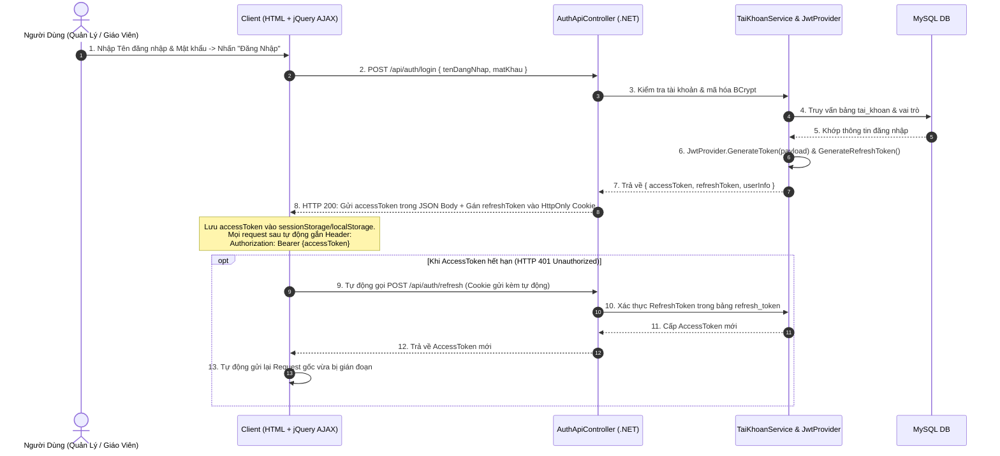

# QUY CHUẨN RESTFUL API, XÁC THỰC JWT VÀ LUỒNG AJAX FRONTEND

> **Mục tiêu**: Chuẩn hóa cách thức Frontend HTML/JavaScript giao tiếp với Backend .NET Web API sử dụng **Xác thực JWT Bearer Token** đồng bộ với Java, cơ chế nạp dữ liệu không reload trang qua **jQuery AJAX**, xử lý **Phân trang, Lọc** và tự động **Làm mới Token (Refresh Token)**.

---

## 1. ĐỊNH DẠNG PHẢN HỒI CHUẨN (GENERIC API ENVELOPE)

Toàn bộ các API trong hệ thống .NET trả về Client đều được bọc trong lớp `ApiResponse<T>` (`dotnet_backend/Common/ApiResponse.cs`) đồng bộ 100% với định dạng của Java:

```json
{
  "success": true,
  "statusCode": 200,
  "message": "Lấy danh sách học sinh thành công",
  "data": {
    "items": [
      {
        "idHs": 105,
        "hoTen": "Nguyễn Văn An",
        "ngaySinh": "2010-05-15",
        "sdt": "0912345678",
        "tenChiNhanh": "Chi nhánh Cầu Giấy",
        "tenLop": "Tiếng Anh Giao Tiếp B1",
        "trangThai": "DANG_HOC"
      }
    ],
    "pageIndex": 1,
    "pageSize": 10,
    "totalCount": 85,
    "totalPages": 9,
    "hasPreviousPage": false,
    "hasNextPage": true
  },
  "errors": null
}
```

---

## 2. LUỒNG XÁC THỰC VÀ QUẢN LÝ JWT TOKEN (AUTHENTICATION FLOW)



---

## 3. THIẾT KẾ MODULE AJAX GIAO TIẾP TẬP TRUNG (`api-client.js`)

Để đảm bảo an toàn và không bị lặp mã, Frontend xây dựng một bộ bọc AJAX tập trung tại `/wwwroot/js/common/api-client.js`:

```javascript
// /wwwroot/js/common/api-client.js
const ApiClient = {
    // 1. Lấy AccessToken hiện tại
    getToken: function() {
        return sessionStorage.getItem('ACCESS_TOKEN') || localStorage.getItem('ACCESS_TOKEN');
    },

    // 2. Gửi Request có tự động đính kèm JWT Bearer Token
    request: function(options) {
        const token = this.getToken();
        const headers = options.headers || {};
        
        if (token) {
            headers['Authorization'] = 'Bearer ' + token;
        }

        return $.ajax({
            url: options.url,
            type: options.type || 'GET',
            contentType: options.contentType !== undefined ? options.contentType : 'application/json',
            data: options.data,
            headers: headers,
            xhrFields: {
                withCredentials: true // Cho phép tự động gửi HttpOnly Cookie RefreshToken
            }
        }).catch((xhr) => {
            // Xử lý tự động Refresh Token nếu gặp lỗi 401
            if (xhr.status === 401 && !options._isRetry) {
                return ApiClient.refreshToken().then((newToken) => {
                    options._isRetry = true;
                    options.headers = options.headers || {};
                    options.headers['Authorization'] = 'Bearer ' + newToken;
                    return $.ajax(options);
                });
            }
            throw xhr;
        });
    },

    // 3. Hàm làm mới Token
    refreshToken: function() {
        return $.ajax({
            url: '/api/auth/refresh',
            type: 'POST',
            xhrFields: { withCredentials: true }
        }).then((res) => {
            if (res.success && res.data.accessToken) {
                sessionStorage.setItem('ACCESS_TOKEN', res.data.accessToken);
                return res.data.accessToken;
            }
            throw new Error('Không thể làm mới token');
        }).catch(() => {
            sessionStorage.removeItem('ACCESS_TOKEN');
            window.location.href = '/login.html';
        });
    }
};
```

---

## 4. CODE MẪU THAO TÁC CÁC NGHIỆP VỤ TRUNG TÂM QUA AJAX

### 4.1. Tải danh sách Học sinh có Phân trang & Tìm kiếm Lọc (Server-side)
```javascript
let filterParams = {
    keyword: '',
    idChiNhanh: 0,
    pageIndex: 1,
    pageSize: 10
};

function loadHocSinhTable() {
    $('#loadingSpinner').removeClass('d-none');

    ApiClient.request({
        url: '/api/v1/hoc-sinh',
        type: 'GET',
        data: filterParams
    }).done(function(response) {
        $('#loadingSpinner').addClass('d-none');
        if (response.success) {
            renderHocSinhRows(response.data.items);
            renderPagination(response.data);
        }
    }).fail(function(xhr) {
        $('#loadingSpinner').addClass('d-none');
        showToast('error', 'Lỗi khi tải danh sách: ' + xhr.statusText);
    });
}
```

### 4.2. Lưu Điểm danh Học sinh theo Lô (Batch Attendance Submission)
```javascript
function submitDiemDanhBatch(idBuoiHoc, attendanceList) {
    // attendanceList là mảng: [ { idHs: 101, trangThai: "CO_MAT", ghiChu: "" }, ... ]
    ApiClient.request({
        url: `/api/v1/buoi-hoc/${idBuoiHoc}/diem-danh-hoc-sinh`,
        type: 'POST',
        data: JSON.stringify(attendanceList)
    }).done(function(res) {
        showToast('success', res.message || 'Lưu điểm danh thành công');
        loadBuoiHocDetail(idBuoiHoc);
    }).fail(function(xhr) {
        showToast('error', 'Lỗi điểm danh: ' + (xhr.responseJSON?.message || 'Có lỗi xảy ra'));
    });
}
```
