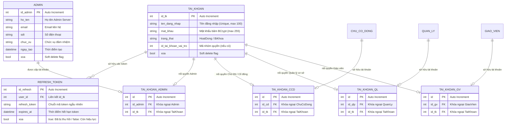
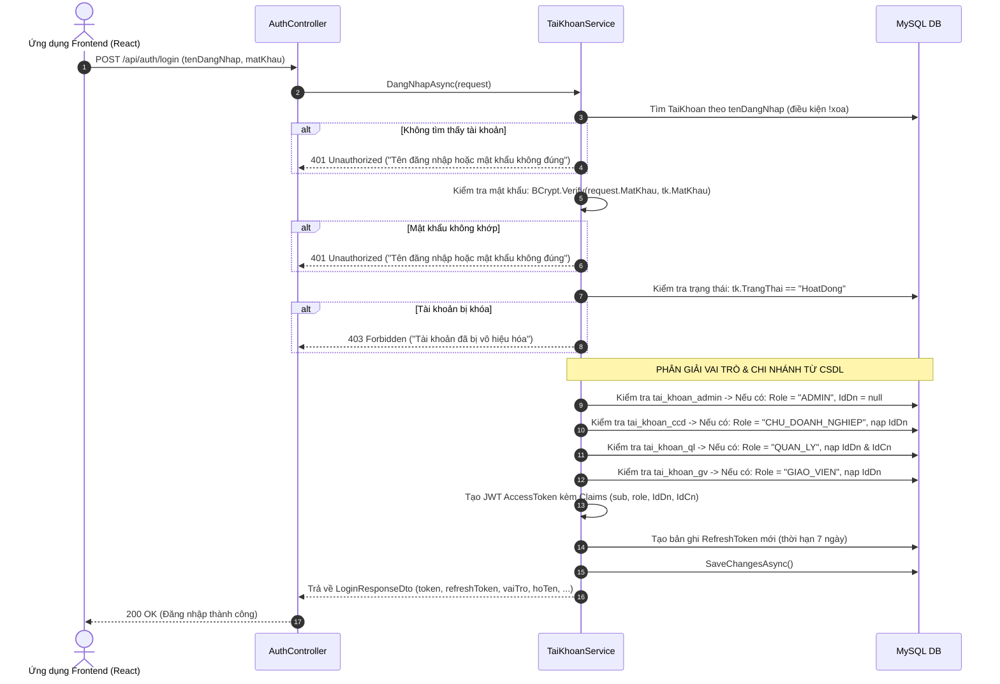

# BẢN ĐỒ NGHIỆP VỤ & THIẾT KẾ CƠ SỞ DỮ LIỆU: TÀI KHOẢN, BẢO MẬT & PHÂN QUYỀN
> **Module ID**: `01_HE_THONG_TAI_KHOAN_SECURITY`  
> **Service cốt lõi**: `ITaiKhoanService` / `TaiKhoanService.cs`, `IAdminService` / `AdminService.cs`  
> **Controllers phụ trách**: `AuthController.cs`, `AdminManagementController.cs`, `AdminTokenController.cs`, `AdminServerController.cs`  
> **Trạng thái**: `[Đã hoàn thành - Đồng bộ 100% Java & .NET]`

---

## 1. TỔNG QUAN PHẠM VI NGHIỆP VỤ (MODULE OVERVIEW)

Module Tài khoản & Bảo mật là "tấm khiên" kiểm soát toàn bộ định danh, phiên làm việc và phân quyền của hệ thống giáo dục đa người dùng:
1. **Xác thực người dùng (Authentication Engine)**:
   - Cơ chế mã hóa mật khẩu an toàn chuẩn công nghiệp bằng thuật toán **BCrypt**.
   - Hỗ trợ cấp phát và xác thực cặp thẻ: **JWT Access Token** (thời hạn ngắn, lưu thông tin vai trò, ID doanh nghiệp, ID chi nhánh) và **Refresh Token** (thời hạn dài, lưu trữ trong CSDL có cơ chế xoay vòng - Token Rotation).
2. **Kiến trúc Phân quyền Đa vai trò (RBAC - Role-Based Access Control)**:
   - Mô hình liên kết 1:1 linh hoạt giữa bảng tài khoản gốc `tai_khoan` với từng bảng thực thể định danh qua 4 bảng nối:
     - `tai_khoan_admin`: Quản trị viên Server toàn quyền (`ROLE_ADMIN`, `ADMIN`).
     - `tai_khoan_ccd`: Chủ Doanh nghiệp / Cổ đông sáng lập (`ROLE_CHU_DOANH_NGHIEP`, `CHU_DOANH_NGHIEP`, `ROLE_CHU_CO_DONG`).
     - `tai_khoan_ql`: Quản lý Chi nhánh / Cơ sở (`ROLE_QUAN_LY`, `QUAN_LY`).
     - `tai_khoan_gv`: Giáo viên đứng lớp (`ROLE_GIAO_VIEN`, `GIAO_VIEN`).
3. **Quản trị Phiên & Thu hồi quyền tức thì (Session & Token Revocation)**:
   - Cho phép Quản trị viên tra cứu toàn bộ danh sách phiên đăng nhập của người dùng toàn hệ thống.
   - Hỗ trợ thu hồi (Revoke/Blacklist) tức thời Refresh Token khi phát hiện truy cập bất thường hoặc người dùng bị sa thải/vô hiệu hóa.
4. **Chuẩn hóa mã lỗi bảo mật tập trung (Centralized Security Exception Handling)**:
   - Can thiệp sự kiện `JwtBearerEvents` trong `Program.cs` (`OnChallenge`, `OnForbidden`) để đảm bảo các lỗi `401 Unauthorized` và `403 Forbidden` luôn trả về cấu trúc JSON `ApiResponse<T>` chuẩn hóa (`THIEU_XAC_THUC`, `TU_CHOI_TRUY_CAP`), ngăn chặn hoàn toàn lỗi trả về trang trắng HTML.

---

## 2. SƠ ĐỒ THỰC THỂ CƠ SỞ DỮ LIỆU (DATABASE SCHEMA & ERD)



---

## 3. CÁC LUỒNG NGHIỆP VỤ & THUẬT TOÁN SERVICE CHI TIẾT

### 3.1. Luồng Đăng nhập & Phân giải Quyền Đa vai trò (Login & Multi-Role Claims Resolution)
Hàm thực thi: `DangNhapAsync(LoginRequestDto request)`



### 3.2. Luồng Làm mới Token & Thu hồi Token (Token Refresh & Revocation)
Hàm thực thi: `LamMoiTokenAsync` & `ThuHoiTokenAsync`

```mermaid
flowchart TD
    Start([Client gửi RefreshToken hết hạn AccessToken]) --> Step1[Truy vấn bảng refresh_token theo mã token]
    Step1 --> CheckValid{Token tồn tại, xoa == false và expires_at > Now?}
    
    CheckValid -- Không hợp lệ / Đã hết hạn --> Throw401["Báo lỗi 401 Unauthorized: Refresh token không hợp lệ hoặc đã hết hạn"]
    CheckValid -- Hợp lệ --> Step2[Truy vấn TaiKhoan theo user_id]
    
    Step2 --> CheckUser{Tài khoản còn hoạt động?}
    CheckUser -- Đã bị khóa / Xóa mềm --> Throw403["Báo lỗi 403 Forbidden: Tài khoản đã bị khóa"]
    CheckUser -- Hoạt động bình thường --> Step3[Đánh dấu RefreshToken cũ: xoa = true (Token Rotation)]
    
    Step3 --> Step4[Tạo AccessToken mới kèm Claims]
    Step3 --> Step5[Tạo RefreshToken mới lưu vào DB]
    
    Step4 --> Commit[Lưu DB & Trả về cặp Token mới cho Client]
    Step5 --> Commit
    Commit --> End([Hoàn tất làm mới Token an toàn])
```

### 3.3. Luồng Đổi mật khẩu an toàn (Password Change Protocol)
Hàm thực thi: `DoiMatKhauAsync(int userId, string oldPassword, string newPassword)`
- Bắt buộc kiểm tra mật khẩu hiện tại bằng `BCrypt.Verify(oldPassword, user.MatKhau)`.
- Kiểm tra độ dài mật khẩu mới (tối thiểu 6 ký tự).
- Băm mật khẩu mới bằng `BCrypt.HashPassword(newPassword)`.
- Tùy chọn: Tự động thu hồi toàn bộ RefreshToken hiện hành để ép đăng xuất trên tất cả thiết bị khác.

---

## 4. MA TRẬN API ENDPOINTS CỦA MODULE BẢO MẬT & TÀI KHOẢN

| Endpoint | Method | Phân quyền (Roles) | Chức năng nghiệp vụ & Logic kiểm tra |
| :--- | :---: | :--- | :--- |
| `/api/auth/login` | `POST` | Public (Công khai) | Xác thực đăng nhập, kiểm tra BCrypt, phân giải vai trò, cấp JWT AccessToken & RefreshToken. |
| `/api/auth/refresh-token` | `POST` | Public (Công khai) | Làm mới AccessToken bằng RefreshToken hợp lệ theo cơ chế xoay vòng. |
| `/api/auth/doi-mat-khau` | `POST` | Người dùng đã đăng nhập | Đổi mật khẩu cá nhân, yêu cầu xác thực mật khẩu cũ chính xác. |
| `/api/admin/quan-tri-vien` | `GET` | Admin Server | Lấy danh sách toàn bộ tài khoản Quản trị viên hệ thống. |
| `/api/admin/quan-tri-vien/{id}` | `GET` | Admin Server | Xem chi tiết thông tin hồ sơ của một Admin Server. |
| `/api/admin/quan-tri-vien` | `POST` | Admin Server | Tạo mới Admin Server, kiểm tra chống trùng username, bọc Transaction CSDL. |
| `/api/admin/quan-tri-vien/{id}` | `PUT` | Admin Server | Cập nhật hồ sơ Admin Server. |
| `/api/admin/quan-tri-vien/{id}` | `DELETE` | Admin Server | Xóa Admin Server, cascade khóa tài khoản liên kết (`xoa = true`), bọc Transaction. |
| `/api/admin/tokens` | `GET` | Admin Server | Xem danh sách tất cả các phiên đăng nhập (RefreshTokens) trên toàn hệ thống. |
| `/api/admin/tokens/{idRefresh}/revoke` | `DELETE` | Admin Server | Thu hồi tức thì phiên đăng nhập của người dùng theo mã `idRefresh`. |
| `/api/admin/server/thong-ke` | `GET` | Admin Server | Thống kê tổng số lượng Doanh nghiệp, Chi nhánh, Giáo viên, Học sinh toàn hệ thống. |
