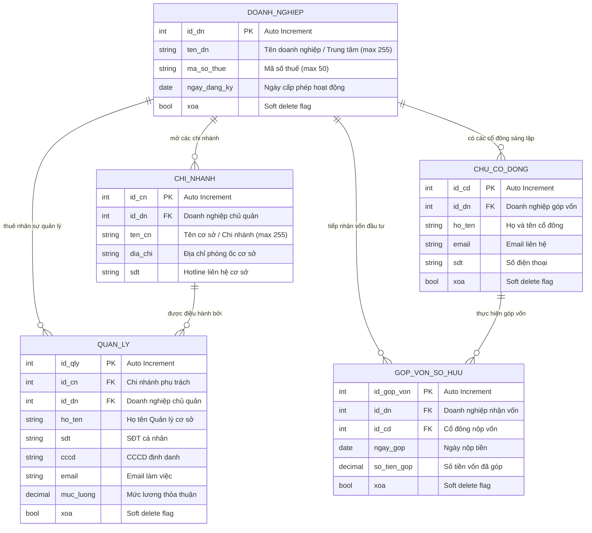
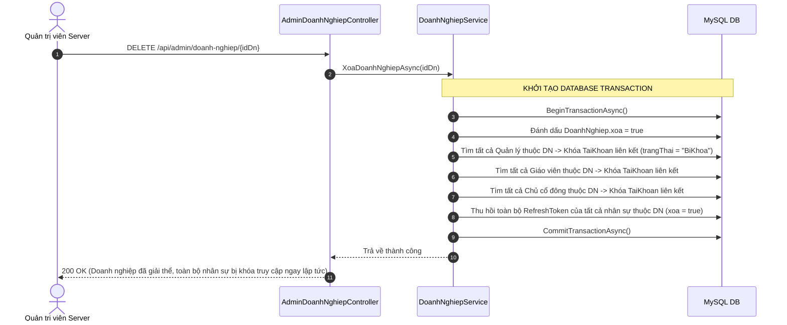
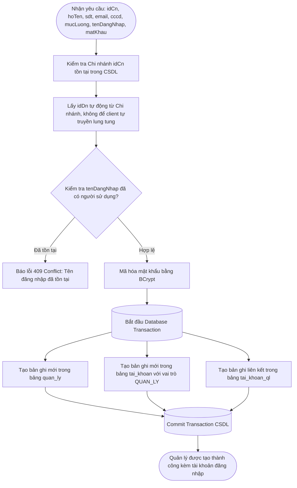

# BẢN ĐỒ NGHIỆP VỤ & THIẾT KẾ CƠ SỞ DỮ LIỆU: DOANH NGHIỆP, CỔ ĐÔNG & CHI NHÁNH
> **Module ID**: `02_DOANH_NGHIEP_CO_DONG_CHI_NHANH`  
> **Service cốt lõi**: `IDoanhNghiepService` / `DoanhNghiepService.cs`  
> **Controllers phụ trách**: `AdminDoanhNghiepController.cs`, `ChuDoanhNghiepChiNhanhController.cs`, `ChuDoanhNghiepCoDongController.cs`, `AdminOwnerController.cs`  
> **Trạng thái**: `[Đã hoàn thành - Đồng bộ 100% Java & .NET]`

---

## 1. TỔNG QUAN PHẠM VI NGHIỆP VỤ (MODULE OVERVIEW)

Module Doanh nghiệp, Cổ đông & Chi nhánh là nền tảng quản trị tổ chức đa chi nhánh (Multi-tenancy Architecture):
1. **Quản trị Pháp nhân Doanh nghiệp (Enterprise Management)**:
   - Đại diện cho một tổ chức / thương hiệu giáo dục vận hành hệ thống.
   - Quản lý mã số thuế, ngày thành lập, thông tin pháp lý.
   - Cơ chế bảo mật khi giải thể: Khi Admin xóa hoặc giải thể một Doanh nghiệp, hệ thống tự động bọc **Database Transaction** để:
     - Đánh dấu xóa mềm Doanh nghiệp (`xoa = true`).
     - Cascade vô hiệu hóa (khóa tài khoản) toàn bộ nhân sự trực thuộc: Chủ cổ đông, Quản lý chi nhánh, Giáo viên.
     - Thu hồi (Revoke) ngay lập tức toàn bộ RefreshToken của tất cả nhân sự thuộc doanh nghiệp đó, ngăn chặn hoàn toàn việc tiếp tục đăng nhập.
2. **Quản trị Mạng lưới Chi nhánh / Cơ sở (Branch Network)**:
   - Cho phép doanh nghiệp mở rộng nhiều cơ sở đào tạo độc lập về mặt địa lý nhưng dùng chung chương trình và dữ liệu tài chính cấp cao.
   - *Lưu ý Schema DBv4*: Bảng `chi_nhanh` không sử dụng cột `xoa` (hard-delete an toàn với kiểm tra ràng buộc không còn lớp học hay nhân sự gắn liền).
3. **Cổ đông & Góp vốn sở hữu (Shareholders & Equity Funding)**:
   - Theo dõi danh sách các thành viên góp vốn (`chu_co_dong`).
   - Ghi nhận lịch sử từng đợt góp vốn (`gop_von_so_huu`) theo ngày nộp và số tiền, làm căn cứ chia cổ tức hoặc tính tỷ lệ biểu quyết.
4. **Bổ nhiệm Quản lý Chi nhánh (Branch Manager Assignment)**:
   - Gán nhân sự Quản lý điều hành cơ sở kèm mức lương cơ bản.
   - Tự động cấp tài khoản đăng nhập với vai trò `ROLE_QUAN_LY` có phạm vi truy cập dữ liệu giới hạn tại đúng chi nhánh được phân công.

---

## 2. SƠ ĐỒ THỰC THỂ CƠ SỞ DỮ LIỆU (DATABASE SCHEMA & ERD)

---

## 3. CÁC LUỒNG NGHIỆP VỤ & THUẬT TOÁN SERVICE CHI TIẾT

### 3.1. Luồng Giải thể Doanh nghiệp & Cascade Khóa Nhân sự Toàn chuỗi
Hàm thực thi: `XoaDoanhNghiepAsync(int idDn)`

### 3.2. Luồng Khởi tạo Quản lý Chi nhánh & Cấp phát Tài khoản
Hàm thực thi: `TaoQuanLyChiNhanhAsync(TaoQuanLyRequest request)`

---

## 4. MA TRẬN API ENDPOINTS CỦA MODULE DOANH NGHIỆP & CHI NHÁNH

| Endpoint | Method | Phân quyền (Roles) | Chức năng nghiệp vụ & Logic kiểm tra |
| :--- | :---: | :--- | :--- |
| `/api/admin/doanh-nghiep` | `GET` | Admin Server | Xem danh sách tất cả các doanh nghiệp trong hệ thống. |
| `/api/admin/doanh-nghiep/{idDn}` | `GET` | Admin Server | Xem chi tiết thông tin pháp nhân doanh nghiệp. |
| `/api/admin/doanh-nghiep` | `POST` | Admin Server | Đăng ký doanh nghiệp mới, kiểm tra trùng mã số thuế. |
| `/api/admin/doanh-nghiep/{idDn}` | `DELETE` | Admin Server | Xóa/giải thể doanh nghiệp, cascade khóa tài khoản nhân sự & thu hồi token. |
| `/api/doanh-nghiep/{idDn}/chi-nhanh` | `GET` | Admin, Chủ DN, Quản lý | Lấy danh sách tất cả các chi nhánh cơ sở của doanh nghiệp. |
| `/api/chi-nhanh/{idCn}` | `GET` | Mọi vai trò xác thực | Xem chi tiết cơ sở chi nhánh. |
| `/api/doanh-nghiep/{idDn}/chi-nhanh` | `POST` | Admin, Chủ DN | Tạo mới chi nhánh cơ sở, tự động gán `idDn` từ doanh nghiệp sở hữu. |
| `/api/chi-nhanh/{idCn}` | `PUT` | Admin, Chủ DN | Cập nhật địa chỉ, tên, số điện thoại chi nhánh. |
| `/api/chi-nhanh/{idCn}` | `DELETE` | Admin, Chủ DN | Xóa chi nhánh cơ sở (kiểm tra ràng buộc không còn lớp học hoạt động). |
| `/api/doanh-nghiep/{idDn}/co-dong` | `GET` | Admin, Chủ DN | Xem danh sách cổ đông sáng lập của doanh nghiệp. |
| `/api/doanh-nghiep/{idDn}/co-dong` | `POST` | Admin, Chủ DN | Thêm cổ đông sáng lập mới, tự động cấp tài khoản đăng nhập. |
| `/api/co-dong/{idCd}` | `DELETE` | Admin, Chủ DN | Xóa cổ đông khỏi danh sách sở hữu. |
| `/api/doanh-nghiep/gop-von` | `POST` | Admin, Chủ DN | Ghi nhận đợt nộp tiền góp vốn của cổ đông vào doanh nghiệp. |
| `/api/chi-nhanh/{idCn}/quan-ly` | `GET` | Admin, Chủ DN | Xem danh sách nhân sự quản lý điều hành cơ sở. |
| `/api/doanh-nghiep/quan-ly` | `POST` | Admin, Chủ DN | Bổ nhiệm Quản lý chi nhánh, bọc Transaction tự cấp tài khoản mã hóa BCrypt. |
| `/api/quan-ly/{idQly}` | `DELETE` | Admin, Chủ DN | Xóa Quản lý cơ sở, khóa tài khoản tương ứng. |
