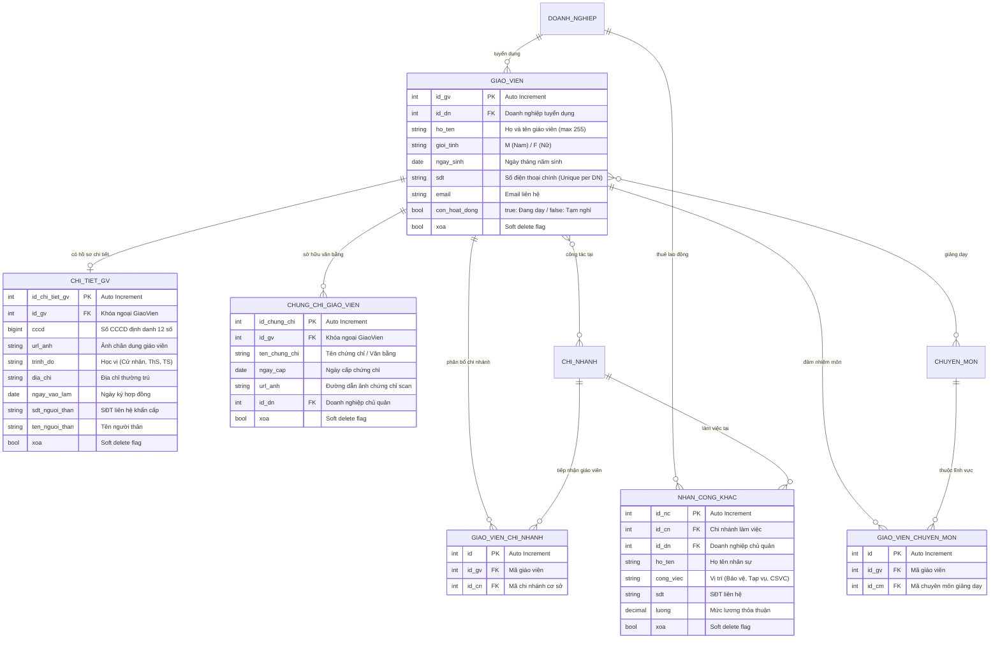
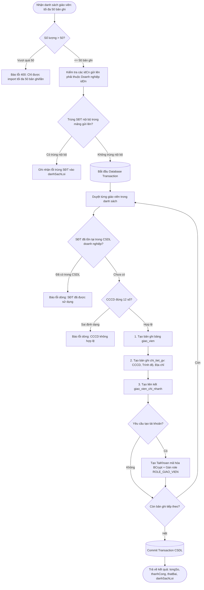

# BẢN ĐỒ NGHIỆP VỤ & THIẾT KẾ CƠ SỞ DỮ LIỆU: NHÂN SỰ, GIÁO VIÊN & HỒ SƠ
> **Module ID**: `03_NHAN_SU_GIAO_VIEN_HO_SO`  
> **Service cốt lõi**: `INhanSuService` / `NhanSuService.cs`  
> **Controllers phụ trách**: `ChuDoanhNghiepNhanSuController.cs`, `GiaoVienHoSoController.cs`, `QuanLyNhanSuController.cs`  
> **Trạng thái**: `[Đã hoàn thành - Đồng bộ 100% Java & .NET]`

---

## 1. TỔNG QUAN PHẠM VI NGHIỆP VỤ (MODULE OVERVIEW)

Module Nhân sự & Giáo viên phụ trách toàn bộ chuỗi quản lý lực lượng giảng dạy và lao động hỗ trợ:
1. **Hồ sơ Giáo viên & Bằng cấp / Chứng chỉ**:
   - Quản lý thông tin cơ bản: Họ tên, Giới tính, Ngày sinh, SĐT, Email, Trạng thái hoạt động.
   - Chi tiết chuyên sâu (`chi_tiet_gv`): Số CCCD, Trình độ học vấn, Ngày vào làm, Thông tin liên hệ người thân khi khẩn cấp, Ảnh đại diện.
   - Văn bằng & Chứng chỉ (`chung_chi_giao_vien`): Lưu trữ tên chứng chỉ, ngày cấp, ảnh chụp minh chứng.
   - Phân bổ Chuyên môn (`giao_vien_chuyen_mon`) và Chi nhánh làm việc (`giao_vien_chi_nhanh`).
2. **Quy trình Nhập giáo viên hàng loạt (Bulk Import Teachers Engine)**:
   - Cho phép doanh nghiệp nạp danh sách giảng viên lớn qua file Excel/JSON với quy chuẩn an toàn cao:
     - Giới hạn tối đa **50 bản ghi/lần gửi**.
     - Kiểm tra xác thực quyền sở hữu chi nhánh (`idCn` phải thuộc `idDn`).
     - Thuật toán chống trùng SĐT 2 lớp (trong nội bộ mảng gửi lên và đối soát với CSDL).
     - Kiểm tra tính hợp lệ của định dạng số CCCD 12 chữ số.
     - Toàn bộ lô nạp được bọc trong **Database Transaction**: Tạo bản ghi Giáo viên, Chi tiết giáo viên, Chi nhánh công tác và **tự động cấp tài khoản đăng nhập với mật khẩu băm BCrypt**.
     - Báo cáo kết quả chi tiết từng dòng (`tongSo`, `thanhCong`, `thatBai`, `danhSachLoi`).
3. **Bảo mật Hồ sơ & Chứng chỉ cá nhân (Ownership Security Protocol)**:
   - Nghiêm cấm can thiệp chéo: Giáo viên đăng nhập chỉ có quyền xem, chỉnh sửa hồ sơ và thêm/xóa các chứng chỉ thuộc quyền sở hữu của chính mình (`idGv == currentUserId`).
4. **Quản lý Nhân công khác (`nhan_cong_khac`)**: Quản lý đội ngũ nhân viên thời vụ, bảo vệ, tạp vụ theo từng chi nhánh cơ sở.

---

## 2. SƠ ĐỒ THỰC THỂ CƠ SỞ DỮ LIỆU (DATABASE SCHEMA & ERD)



---

## 3. CÁC LUỒNG NGHIỆP VỤ & THUẬT TOÁN SERVICE CHI TIẾT

### 3.1. Thuật toán Nhập giáo viên hàng loạt an toàn (Transactional Bulk Import Engine)
Hàm thực thi: `LuuGiaoVienHangLoatAsync(int idDn, List<GiaoVienBulkDto> danhSach)`



### 3.2. Luồng Bảo vệ quyền sở hữu Chứng chỉ cá nhân
Hàm thực thi: `GiaoVienHoSoController.ThemChungChiGiaoVien`, `XoaChungChiGiaoVien`
- **Nguyên tắc bảo mật**:
  ```csharp
  // Lấy ID giáo viên đang đăng nhập từ JWT Token
  int currentGvId = LayIdGiaoVienHienTai();
  if (currentGvId != idGv)
  {
      return ApiResponse<bool>.Forbidden("Bạn không có quyền can thiệp vào hồ sơ giáo viên khác.");
  }
  ```

---

## 4. MA TRẬN API ENDPOINTS CỦA MODULE NHÂN SỰ & GIÁO VIÊN

| Endpoint | Method | Phân quyền (Roles) | Chức năng nghiệp vụ & Logic kiểm tra |
| :--- | :---: | :--- | :--- |
| `/api/doanh-nghiep/nhan-su/teachers` | `GET` | Admin, Chủ DN, Quản lý | Lấy danh sách giáo viên có phân trang, lọc theo chi nhánh, chuyên môn, keyword. |
| `/api/doanh-nghiep/giao-vien/{id}` | `GET` | Mọi vai trò xác thực | Xem chi tiết hồ sơ giáo viên kèm bằng cấp và chi nhánh công tác. |
| `/api/doanh-nghiep/giao-vien` | `POST` | Admin, Chủ DN, Quản lý | Thêm mới 1 giáo viên, kiểm tra trùng SĐT trong doanh nghiệp (409 Conflict). |
| `/api/doanh-nghiep/nhan-su/teachers/bulk` | `POST` | Admin, Chủ DN, Quản lý | **Import giáo viên hàng loạt** (tối đa 50 bản ghi, Transaction, tự cấp tài khoản). |
| `/api/doanh-nghiep/giao-vien/{id}` | `PUT` | Admin, Chủ DN, Quản lý | Cập nhật thông tin cơ bản của giáo viên. |
| `/api/doanh-nghiep/giao-vien/{id}` | `DELETE` | Admin, Chủ DN | Xóa mềm giáo viên (`xoa = true`), khóa tài khoản đăng nhập tương ứng. |
| `/api/giao-vien/ho-so/me` | `GET` | Giáo viên | Giáo viên xem thông tin hồ sơ cá nhân và chuyên môn của chính mình. |
| `/api/giao-vien/ho-so/me` | `PUT` | Giáo viên | Giáo viên cập nhật địa chỉ, SĐT khẩn cấp của người thân. |
| `/api/giao-vien/{idGv}/chung-chi` | `GET` | Giáo viên, Quản lý, Chủ DN | Lấy danh sách chứng chỉ văn bằng của giáo viên. |
| `/api/giao-vien/ho-so/chung-chi` | `POST` | Giáo viên | Thêm mới chứng chỉ cá nhân, upload ảnh scan văn bằng. |
| `/api/giao-vien/ho-so/chung-chi/{id}` | `DELETE` | Giáo viên | Xóa chứng chỉ cá nhân (kiểm tra quyền sở hữu). |
| `/api/doanh-nghiep/{idDn}/chi-nhanh/{idCn}/nhan-cong` | `GET` | Admin, Chủ DN, Quản lý | Lấy danh sách nhân công hỗ trợ (bảo vệ, tạp vụ) tại chi nhánh. |
| `/api/doanh-nghiep/nhan-cong` | `POST` | Admin, Chủ DN, Quản lý | Thêm mới nhân công khác kèm thỏa thuận mức lương. |
| `/api/doanh-nghiep/nhan-cong/{id}` | `DELETE` | Admin, Chủ DN, Quản lý | Xóa mềm nhân công khác. |
