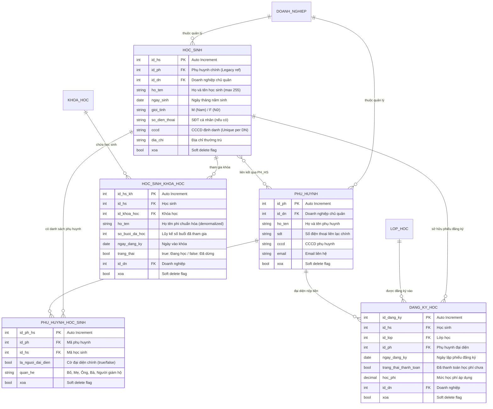
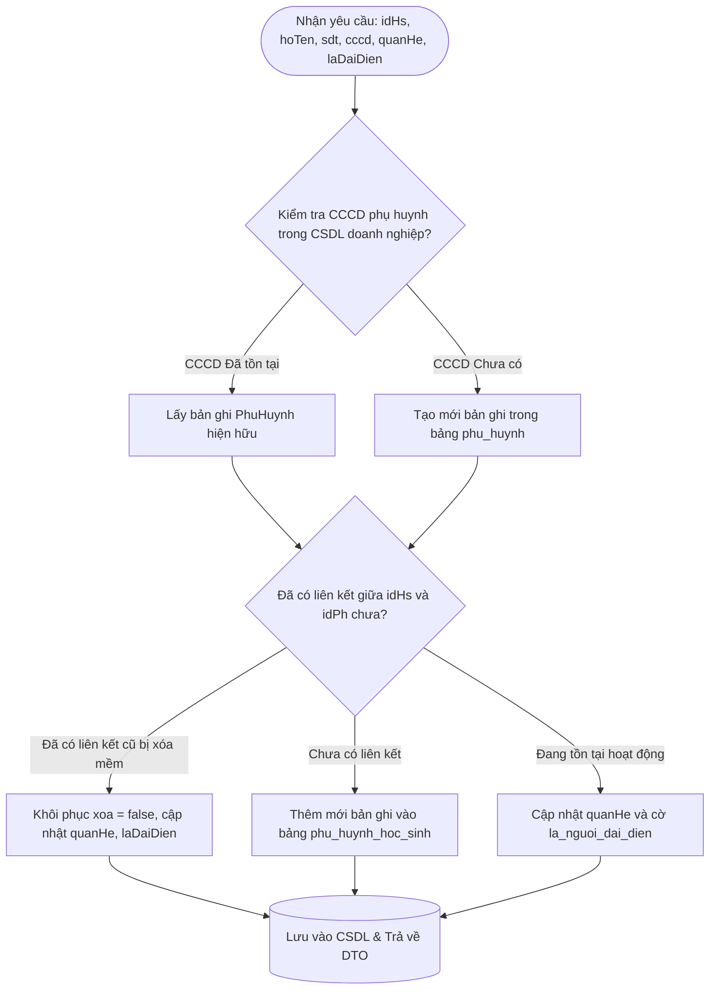
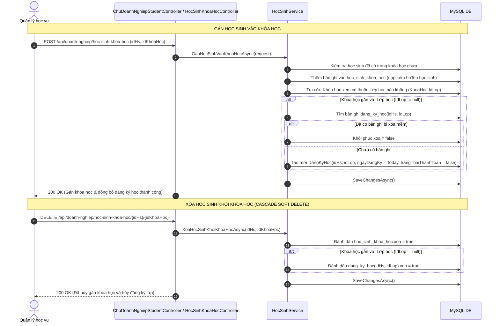

# BẢN ĐỒ NGHIỆP VỤ & THIẾT KẾ CƠ SỞ DỮ LIỆU: HỌC SINH, PHỤ HUYNH & ĐĂNG KÝ HỌC
> **Module ID**: `04_HOC_SINH_PHU_HUYNH_DANG_KY_HOC`  
> **Service cốt lõi**: `IHocSinhService` / `HocSinhService.cs`  
> **Controllers phụ trách**: `ChuDoanhNghiepStudentController.cs`, `HocSinhKhoaHocController.cs`, `QuanLyHoSoHocSinh360Controller.cs`  
> **Trạng thái**: `[Đã hoàn thành - Đồng bộ 100% Java & .NET]`

---

## 1. TỔNG QUAN PHẠM VI NGHIỆP VỤ (MODULE OVERVIEW)

Module Học sinh & Phụ huynh đảm nhiệm việc quản lý vòng đời học viên từ khi tiếp cận đến khi theo học:
1. **Hồ sơ học sinh 360**: Quản lý thông tin định danh cá nhân (Họ tên, Ngày sinh, Giới tính, SĐT, CCCD, Địa chỉ). Kiểm tra chống trùng số CCCD nghiêm ngặt trong phạm vi doanh nghiệp.
2. **Quan hệ đa chiều Phụ huynh - Học sinh (M:N)**:
   - Mô hình linh hoạt: 1 phụ huynh có thể có nhiều con đang theo học tại trung tâm; 1 học sinh có thể có nhiều người giám hộ (Bố, Mẹ, Người giám hộ hợp pháp).
   - Thiết lập cờ `la_nguoi_dai_dien` (người nhận thông báo chính và chịu trách nhiệm nộp học phí).
   - Tính năng tự động tái sử dụng hồ sơ phụ huynh: Khi thêm phụ huynh cho học sinh, nếu số CCCD đã tồn tại trong CSDL thì tự động tạo liên kết mới trong bảng trung gian `phu_huynh_hoc_sinh`, tránh nhân bản dữ liệu rác.
3. **Gán học sinh vào Khóa học & Cascade Đăng ký học**:
   - Khi gán học sinh vào khóa học thuộc một lớp học cụ thể, hệ thống tự động kiểm tra và khởi tạo (hoặc khôi phục) bản ghi `dang_ky_hoc`.
   - Hỗ trợ gán đơn lẻ hoặc gán hàng loạt (`batch assign`).
   - Cascade soft-delete: Khi xóa học sinh khỏi khóa học/lớp học, bản ghi tương ứng trong `dang_ky_hoc` sẽ tự động được đánh dấu xóa mềm (`xoa = true`).
4. **Đồng bộ dữ liệu phi chuẩn hóa (Denormalization Sync)**: Khi cập nhật họ tên học sinh tại bảng gốc `hoc_sinh`, hệ thống tự động cascade cập nhật cột `ho_ten` trên bảng `hoc_sinh_khoa_hoc` để đảm bảo tốc độ hiển thị danh sách lớp mà không bị lệch dữ liệu.

---

## 2. SƠ ĐỒ THỰC THỂ CƠ SỞ DỮ LIỆU (DATABASE SCHEMA & ERD)

---

## 3. CÁC LUỒNG NGHIỆP VỤ & THUẬT TOÁN SERVICE CHI TIẾT

### 3.1. Luồng Thêm mới / Cập nhật Phụ huynh thông minh (Auto Deduplication)
Hàm thực thi: `TaoMoiPhuHuynhChoHocSinhAsync(int idHs, TaoPhuHuynhChoHocSinhRequest request)`

### 3.2. Luồng Đồng bộ 2 chiều: Học sinh Khóa học $\leftrightarrow$ Đăng ký học (DangKyHoc Sync Engine)
Hàm thực thi: `GanHocSinhVaoKhoaHocAsync`, `GanNhieuHocSinhVaoKhoaHocAsync`, `XoaHocSinhKhoiKhoaHocAsync`

---

## 4. MA TRẬN API ENDPOINTS CỦA MODULE HỌC SINH & PHỤ HUYNH

| Endpoint | Method | Phân quyền (Roles) | Chức năng nghiệp vụ & Logic kiểm tra |
| :--- | :---: | :--- | :--- |
| `/api/doanh-nghiep/hoc-sinh` | `GET` | Admin, Chủ DN, Quản lý | Lấy danh sách học sinh có phân trang, hỗ trợ lọc chi nhánh, từ khóa tìm kiếm. |
| `/api/hoc-sinh/{id}` | `GET` | Mọi vai trò xác thực | Xem chi tiết học sinh kèm danh sách phụ huynh liên kết. |
| `/api/doanh-nghiep/hoc-sinh` | `POST` | Admin, Chủ DN, Quản lý | Tạo học sinh mới, kiểm tra trùng số CCCD trong doanh nghiệp (báo 409 Conflict). |
| `/api/doanh-nghiep/hoc-sinh/{id}` | `PUT` | Admin, Chủ DN, Quản lý | Cập nhật hồ sơ học sinh, cascade đồng bộ `ho_ten` sang bảng `hoc_sinh_khoa_hoc`. |
| `/api/doanh-nghiep/hoc-sinh/{id}` | `DELETE` | Admin, Chủ DN | Xóa mềm học sinh (`xoa = true`), ngắt các liên kết đào tạo hiện thời. |
| `/api/hoc-sinh/{idHs}/phu-huynh` | `GET` | Mọi vai trò xác thực | Lấy danh sách toàn bộ phụ huynh/người giám hộ của học sinh. |
| `/api/phu-huynh/{idPh}/hoc-sinh` | `GET` | Mọi vai trò xác thực | Lấy danh sách tất cả các con đang học của một phụ huynh. |
| `/api/hoc-sinh/{idHs}/phu-huynh` | `POST` | Admin, Chủ DN, Quản lý | Thêm mới phụ huynh cho học sinh, tự động tái sử dụng hồ sơ nếu trùng CCCD. |
| `/api/phu-huynh-hoc-sinh` | `POST` | Admin, Chủ DN, Quản lý | Tạo liên kết giữa phụ huynh có sẵn và học sinh (gán cờ đại diện & mối quan hệ). |
| `/api/phu-huynh-hoc-sinh/{idPhHs}` | `DELETE` | Admin, Chủ DN, Quản lý | Xóa quan hệ phụ huynh - học sinh theo ID bản ghi trung gian. |
| `/api/phu-huynh-hoc-sinh/{idHs}/{idPh}`| `DELETE` | Admin, Chủ DN, Quản lý | Xóa quan hệ phụ huynh - học sinh theo cặp ID. |
| `/api/doanh-nghiep/hoc-sinh-khoa-hoc` | `POST` | Admin, Chủ DN, Quản lý | Gán học sinh vào khóa học, tự động đồng bộ tạo bản ghi `dang_ky_hoc`. |
| `/api/doanh-nghiep/hoc-sinh-khoa-hoc/hang-loat` | `POST` | Admin, Chủ DN, Quản lý | Gán hàng loạt học sinh vào khóa học trong 1 request. |
| `/api/doanh-nghiep/hoc-sinh-khoa-hoc/{idHs}/{idKhoaHoc}` | `DELETE` | Admin, Chủ DN, Quản lý | Xóa học sinh khỏi khóa học, cascade soft-delete bản ghi `dang_ky_hoc`. |
