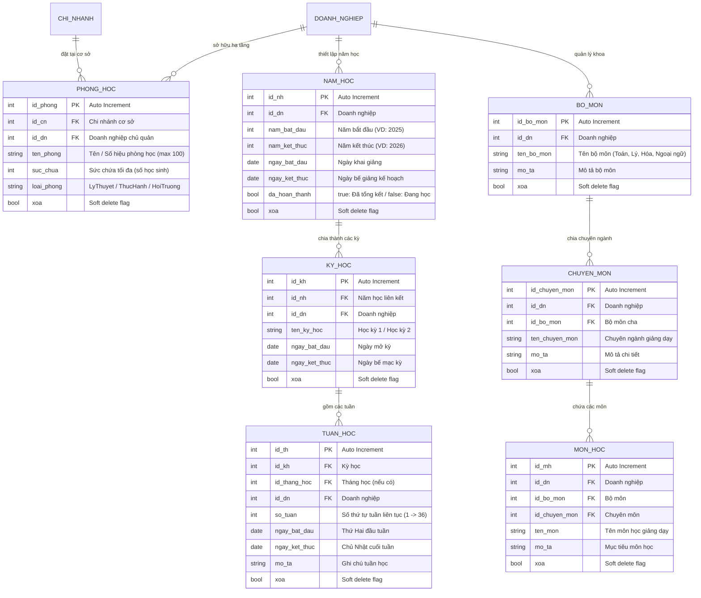

# BẢN ĐỒ NGHIỆP VỤ & THIẾT KẾ CƠ SỞ DỮ LIỆU: CƠ SỞ VẬT CHẤT & KHUNG CHU KỲ ĐÀO TẠO
> **Module ID**: `05_CO_SO_VAT_CHAT_KHUNG_DAO_TAO`  
> **Service cốt lõi**: `ICoSoVatChatService` / `CoSoVatChatService.cs`  
> **Controllers phụ trách**: `QuanLyPhongHocController.cs`, `ChungDaoTaoController.cs`, `ChuDoanhNghiepDaoTaoController.cs`, `TimKiemNhanhController.cs`  
> **Trạng thái**: `[Đã hoàn thành - Đồng bộ 100% Java & .NET]`

---

## 1. TỔNG QUAN PHẠM VI NGHIỆP VỤ (MODULE OVERVIEW)

Module Cơ sở vật chất & Khung chu kỳ đào tạo thiết lập toàn bộ hạ tầng vật lý và trục thời gian cho hoạt động giảng dạy:
1. **Quản trị Phòng học & Hạ tầng cơ sở (`phong_hoc`)**:
   - Quản lý danh mục phòng học theo từng chi nhánh, sức chứa tối đa và phân loại phòng (Phòng lý thuyết, Phòng thực hành thí nghiệm, Hội trường lớn).
   - Kiểm tra chống trùng lặp tên phòng học trong cùng một chi nhánh cơ sở.
2. **Cây danh mục chương trình đào tạo 3 cấp (Curriculum Taxonomy Tree)**:
   - Cấu trúc phân cấp hình cây: **Bộ môn (`bo_mon`) $\rightarrow$ Chuyên môn (`chuyen_mon`) $\rightarrow$ Môn học (`mon_hoc`)**.
   - Hỗ trợ tra cứu nhanh cấu trúc đào tạo phục vụ giao diện cây phân cấp (Tree-view) và các dropdown lọc dữ liệu trên toàn hệ thống.
3. **Động cơ Sinh chu kỳ thời gian đào tạo 36 tuần liên tục (Academic Calendar Engine)**:
   - Tự động phân chia năm học thành 2 kỳ học chính thức (Kỳ 1 và Kỳ 2).
   - Thuật toán sinh tuần học tự động (`TaoTuanHocHangLoatAsync`): Tính toán chính xác ngày bắt đầu và kết thúc của từng tuần dựa trên ngày mở năm học; **đánh số liên tục từ tuần 1 đến tuần 36** xuyên suốt năm học (không bị reset về tuần 1 khi sang Kỳ 2).
   - Cơ chế Idempotent: Chống sinh trùng lặp số tuần nếu quản trị viên nhấn tạo nhiều lần.
4. **Ràng buộc thời gian Đổi trạng thái hoàn thành Năm học**:
   - Quy chuẩn nghiệp vụ: Chỉ cho phép đổi trạng thái hoàn thành năm học trong phạm vi **$\pm 1$ tháng** quanh ngày kết thúc kế hoạch của năm học (`ngay_ket_thuc`).
5. **Động cơ Tìm kiếm nhanh toàn hệ thống (Global Universal Search Engine)**:
   - Cho phép tìm kiếm tức thời theo **Số điện thoại** hoặc **CCCD** trên toàn bộ 3 nhóm người dùng: Giáo viên, Quản lý, Học sinh thuộc doanh nghiệp.

---

## 2. SƠ ĐỒ THỰC THỂ CƠ SỞ DỮ LIỆU (DATABASE SCHEMA & ERD)



---

## 3. CÁC LUỒNG NGHIỆP VỤ & THUẬT TOÁN SERVICE CHI TIẾT

### 3.1. Thuật toán Sinh chu kỳ 36 tuần học liên tục xuyên suốt Năm học
Hàm thực thi: `TaoTuanHocHangLoatAsync(int idNh)`

```mermaid
flowchart TD
    Start([Nhận yêu cầu: idNh - Năm học]) --> Step1[Lấy thông tin Năm học từ CSDL: ngayBatDau, ngayKetThuc, idDn]
    Step1 --> Step2{Năm học đã có 2 kỳ học chưa?}
    
    Step2 -- Chưa có --> Create2Ky[Tự động tạo Kỳ 1 (tháng 9 -> tháng 1) & Kỳ 2 (tháng 1 -> tháng 5)]
    Step2 -- Đã có --> GetKyHocs[Lấy danh sách 2 kỳ học hiện hành]
    Create2Ky --> GetKyHocs
    
    GetKyHocs --> InitCounter[Khởi tạo tuần bắt đầu: soTuan = 1, currentMonday = ngayBatDau]
    
    InitCounter --> Loop36{soTuan <= 36?}
    Loop36 -- Đúng --> CalcWeek[Tính: ngayBatDauTuan = currentMonday, ngayKetThucTuan = currentMonday + 6 ngày]
    
    CalcWeek --> PickTerm{soTuan <= 18?}
    PickTerm -- <= 18 --> AssignKy1[Gán thuộc Kỳ 1]
    PickTerm -- > 18 --> AssignKy2[Gán thuộc Kỳ 2]
    
    AssignKy1 --> CheckExist{Tuần số soTuan đã có trong DB?}
    AssignKy2 --> CheckExist
    
    CheckExist -- Chưa có --> InsertTuan[Tạo bản ghi TuanHoc mới trong CSDL]
    CheckExist -- Đã có --> SkipInsert[Bỏ qua bản ghi trùng]
    
    InsertTuan --> NextWeek[currentMonday += 7 ngày; soTuan += 1]
    SkipInsert --> NextWeek
    NextWeek --> Loop36
    
    Loop36 -- Sai (> 36) --> CommitDB[(Lưu CSDL & Trả về danh sách 36 tuần học)]
    CommitDB --> End([Hoàn tất sinh 36 tuần học liên tục không bị reset số tuần])
```

### 3.2. Ràng buộc thời gian Đổi trạng thái Hoàn thành Năm học
Hàm thực thi: `DoiTrangThaiHoanThanhNamHocAsync(int idNamHoc)`

```mermaid
flowchart TD
    StartRule([Yêu cầu đổi trạng thái năm học]) --> FetchNH[Lấy ngayKetThuc của năm học từ CSDL]
    FetchNH --> CalcBounds[Tính giới hạn: tuNgay = ngayKetThuc - 1 tháng; denNgay = ngayKetThuc + 1 tháng]
    
    CalcBounds --> CheckNow{Ngày hiện tại Today có nằm trong khoảng [tuNgay, denNgay]?}
    CheckNow -- Không nằm trong khoảng --> ThrowRuleError["Báo lỗi 400: Chỉ được đổi trạng thái hoàn thành trong vòng ±1 tháng quanh ngày kết thúc năm học"]
    CheckNow -- Nằm trong khoảng hợp lệ --> ToggleStatus[Đảo cờ: da_hoan_thanh = !da_hoan_thanh]
    
    ToggleStatus --> SaveDB[(Lưu CSDL và trả về thành công)]
    SaveDB --> EndRule([Trạng thái năm học được cập nhật an toàn])
```

---

## 4. MA TRẬN API ENDPOINTS CỦA MODULE CƠ SỞ VẬT CHẤT & CHU KỲ

| Endpoint | Method | Phân quyền (Roles) | Chức năng nghiệp vụ & Logic kiểm tra |
| :--- | :---: | :--- | :--- |
| `/api/chi-nhanh/{idCn}/phong-hoc` | `GET` | Mọi vai trò xác thực | Lấy danh sách tất cả các phòng học tại một chi nhánh cơ sở. |
| `/api/phong-hoc/{id}` | `GET` | Mọi vai trò xác thực | Xem chi tiết thông tin và sức chứa của phòng học. |
| `/api/doanh-nghiep/phong-hoc` | `POST` | Admin, Chủ DN, Quản lý | Tạo mới phòng học, kiểm tra chống trùng tên phòng trong chi nhánh. |
| `/api/phong-hoc/{id}` | `DELETE` | Admin, Chủ DN, Quản lý | Xóa mềm phòng học (`xoa = true`). |
| `/api/doanh-nghiep/nam-hoc` | `GET` | Mọi vai trò xác thực | Xem danh sách tất cả năm học thuộc doanh nghiệp. |
| `/api/doanh-nghiep/nam-hoc` | `POST` | Admin, Chủ DN | Khởi tạo năm học mới kèm ngày bắt đầu và kết thúc. |
| `/api/doanh-nghiep/nam-hoc/{id}/hoan-thanh` | `PUT` | Admin, Chủ DN | Đổi trạng thái hoàn thành năm học (ràng buộc kiểm tra phạm vi $\pm 1$ tháng). |
| `/api/nam-hoc/{idNh}/ky-hoc` | `GET` | Mọi vai trò xác thực | Lấy danh sách các kỳ học thuộc năm học. |
| `/api/ky-hoc/{idKh}/tuan-hoc` | `GET` | Mọi vai trò xác thực | Xem danh sách các tuần học thuộc kỳ học. |
| `/api/nam-hoc/{idNh}/sinh-tuan-hoc` | `POST` | Admin, Chủ DN | **Sinh tự động 36 tuần học liên tục** xuyên suốt 2 kỳ học. |
| `/api/doanh-nghiep/bo-mon` | `GET` | Mọi vai trò xác thực | Lấy danh sách bộ môn đào tạo của doanh nghiệp. |
| `/api/doanh-nghiep/chuyen-mon` | `GET` | Mọi vai trò xác thực | Lấy danh sách chuyên môn giảng dạy. |
| `/api/doanh-nghiep/mon-hoc` | `GET` | Mọi vai trò xác thực | Lấy danh mục các môn học chi tiết. |
| `/api/tim-kiem/tat-ca/sdt` | `GET` | Admin, Chủ DN, Quản lý | **Tìm kiếm nhanh đa năng theo SĐT** trên toàn bộ Giáo viên, Quản lý, Học sinh. |
| `/api/tim-kiem/tat-ca/cccd` | `GET` | Admin, Chủ DN, Quản lý | **Tìm kiếm nhanh đa năng theo CCCD** trên toàn bộ hệ sinh thái người dùng. |
