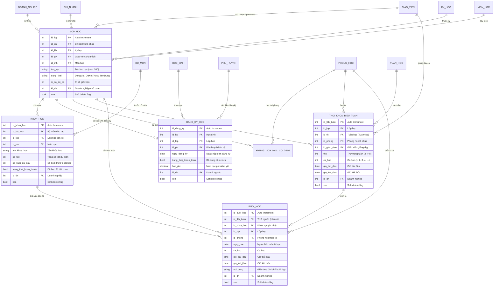
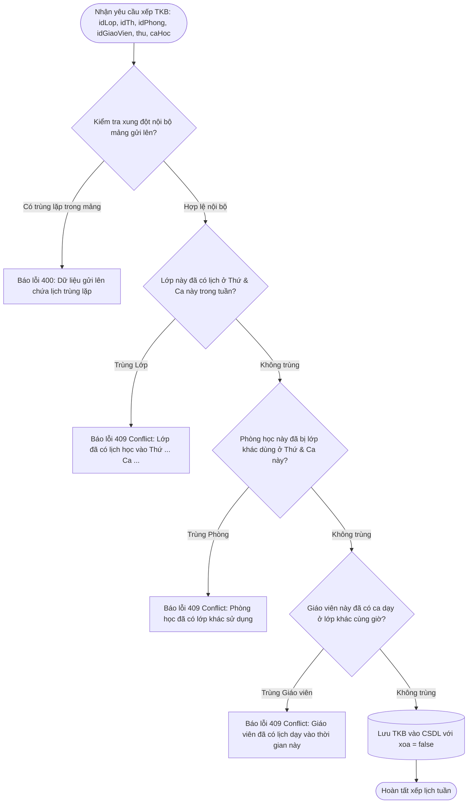
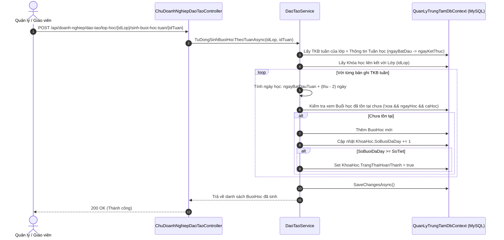

# BẢN ĐỒ NGHIỆP VỤ & THIẾT KẾ CƠ SỞ DỮ LIỆU: ĐÀO TẠO, LỚP HỌC & THỜI KHÓA BIỂU
> **Module ID**: `06_DAO_TAO_LOP_HOC_THOI_KHOA_BIEU`  
> **Service cốt lõi**: `IDaoTaoService` / `DaoTaoService.cs`  
> **Controllers phụ trách**: `ChuDoanhNghiepDaoTaoController.cs`, `ChungDaoTaoController.cs`, `AdminDaoTaoController.cs`, `QuanLyLopHocController.cs`, `QuanLyThoiKhoaBieuController.cs`, `GiaoVienLopHocController.cs`, `GiaoVienThoiKhoaBieuController.cs`  
> **Trạng thái**: `[Đã hoàn thành - Đồng bộ 100% Java & .NET]`

---

## 1. TỔNG QUAN PHẠM VI NGHIỆP VỤ (MODULE OVERVIEW)

Module Đào tạo là "trái tim" vận hành của toàn bộ trung tâm giáo dục, đảm nhiệm chuỗi liên kết:
1. **Tổ chức lớp học**: Khởi tạo lớp học theo chi nhánh, kỳ học, môn học; phân công giáo viên phụ trách; quản lý sĩ số tối đa.
2. **Khóa học / Chương trình học**: Tạo các khóa học theo bộ môn / lớp học; theo dõi số tiết kế hoạch, số buổi đã dạy thực tế và tự động cập nhật trạng thái hoàn thành khóa học.
3. **Quản lý lịch học**:
   - *Khung lịch cố định*: Lịch mẫu theo thứ trong tuần và ca học.
   - *Thời khóa biểu tuần*: Lịch cụ thể theo tuần học, phòng học, giáo viên, thứ, ca học, giờ bắt đầu/kết thúc.
   - *Buổi học thực tế*: Sinh ra từ TKB tuần để làm căn cứ điểm danh và thanh toán công dạy.
4. **Đăng ký học & Tiếp nhận học sinh**: Ghi nhận học sinh tham gia lớp học, tính học phí cơ sở, đồng bộ trạng thái thanh toán và hỗ trợ rút hồ sơ / hủy đăng ký / xóa khỏi lớp.

---

## 2. SƠ ĐỒ THỰC THỂ CƠ SỞ DỮ LIỆU (DATABASE SCHEMA & ERD)



---

## 3. CÁC LUỒNG NGHIỆP VỤ & THUẬT TOÁN SERVICE CHI TIẾT

### 3.1. Thuật toán kiểm tra xung đột thời khóa biểu 3 lớp (Conflict Detection Engine)
Hàm thực thi: `LuuThoiKhoaBieuTuanAsync` & `LuuThoiKhoaBieuHangLoatAsync`



### 3.2. Luồng tự động sinh buổi học & Cập nhật tiến độ khóa học
Hàm thực thi: `TuDongSinhBuoiHocTheoTuanAsync`, `LuuBuoiHocAsync`, `XoaBuoiHocAsync`



### 3.3. Ràng buộc thời gian đào tạo (Historical Immutability Rule)
- **Quy tắc**: Hệ thống nghiêm cấm chỉnh sửa hoặc xóa Buổi học / TKB đã diễn ra trong quá khứ nhằm bảo toàn dữ liệu điểm danh và tính công lương.
- **Ràng buộc**:
  ```csharp
  if (buoiHoc.NgayHoc.HasValue && buoiHoc.NgayHoc.Value < DateOnly.FromDateTime(DateTime.Today))
  {
      return ApiResponse<bool>.BadRequest("Không được phép chỉnh sửa hoặc xóa buổi học đã diễn ra trong quá khứ.");
  }
  ```

---

## 4. MA TRẬN API ENDPOINTS CỦA MODULE ĐÀO TẠO

| Endpoint | Method | Phân quyền (Roles) | Chức năng nghiệp vụ & Logic kiểm tra |
| :--- | :---: | :--- | :--- |
| `/api/dao-tao/lop-hoc` | `GET` | Admin, Chủ DN, Quản lý | Lấy danh sách lớp học có phân trang, lọc theo chi nhánh, môn học, giáo viên, keyword. |
| `/api/dao-tao/lop-hoc/{id}` | `GET` | Mọi vai trò xác thực | Xem chi tiết lớp học kèm chi nhánh, kỳ học, môn học, giáo viên phụ trách. |
| `/api/dao-tao/lop-hoc` | `POST` | Admin, Chủ DN, Quản lý | Tạo lớp học mới, validate sĩ số tối đa > 0, kiểm tra chi nhánh thuộc doanh nghiệp. |
| `/api/dao-tao/lop-hoc/{id}` | `PUT` | Admin, Chủ DN, Quản lý | Cập nhật thông tin lớp, sĩ số, trạng thái. |
| `/api/dao-tao/lop-hoc/{id}` | `DELETE` | Admin, Chủ DN | Cascade soft-delete lớp học, khóa học trực thuộc và TKB liên quan. |
| `/api/dao-tao/lop-hoc/{id}/phan-cong-giao-vien/{idGv}` | `PUT` | Admin, Chủ DN, Quản lý | Phân công giáo viên chủ nhiệm, kiểm tra GV phải đang hoạt động tại chi nhánh. |
| `/api/dao-tao/khoa-hoc` | `GET` | Mọi vai trò xác thực | Lấy danh sách khóa học lọc theo môn, bộ môn hoặc lớp học. |
| `/api/dao-tao/khoa-hoc` | `POST` | Admin, Chủ DN, Quản lý | Tạo khóa học, gán số tiết dự kiến, khởi tạo `so_buoi_da_day = 0`, `trang_thai_hoan_thanh = false`. |
| `/api/dao-tao/thoi-khoa-bieu/tuan` | `POST` | Admin, Chủ DN, Quản lý | Lưu 1 bản ghi TKB tuần, kích hoạt thuật toán chống trùng 3 lớp. |
| `/api/dao-tao/thoi-khoa-bieu/tuan/hang-loat` | `POST` | Admin, Chủ DN, Quản lý | Lưu danh sách TKB, kiểm tra xung đột chéo nội bộ lô gửi lên trước khi lưu DB. |
| `/api/dao-tao/thoi-khoa-bieu/tuan/{id}` | `DELETE` | Admin, Chủ DN, Quản lý | Xóa TKB tuần, kiểm tra ràng buộc không xóa lịch trong quá khứ. |
| `/api/doanh-nghiep/dao-tao/lop-hoc/{idLop}/sinh-buoi-hoc-tuan/{idTuan}` | `POST` | Admin, Chủ DN, Quản lý | Sinh buổi học tự động từ TKB tuần, tăng `so_buoi_da_day` tương ứng. |
| `/api/dao-tao/dang-ky-hoc` | `POST` | Admin, Chủ DN, Quản lý | Đăng ký học sinh vào lớp, kiểm tra sĩ số chưa vượt mức, gán mức học phí. |
| `/api/dao-tao/dang-ky-hoc/{idDangKy}/huy` | `PUT` | Admin, Chủ DN, Quản lý | Hủy đăng ký học, cập nhật `trang_thai_thanh_toan = false`, ghi nhận trạng thái. |
| `/api/dao-tao/lop-hoc/{idLop}/xoa-hoc-sinh/{idHs}` | `DELETE` | Admin, Chủ DN, Quản lý | Xóa học sinh khỏi lớp, cascade soft-delete bản ghi `dang_ky_hoc`. |
