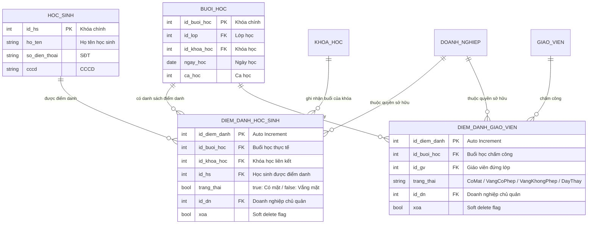
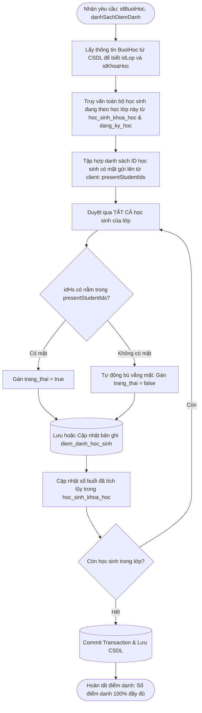
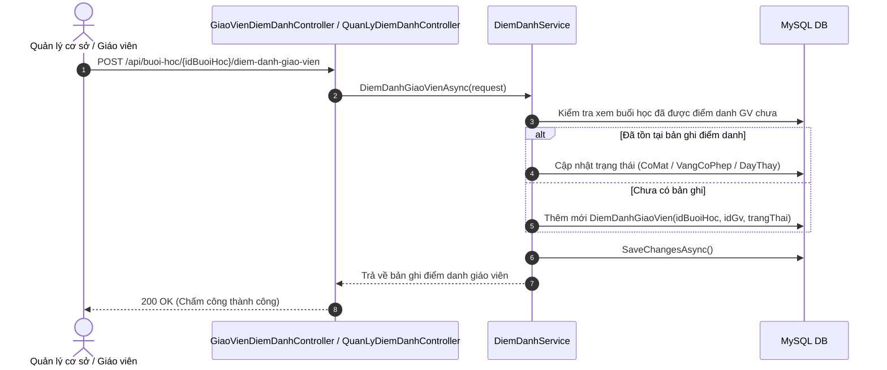

# BẢN ĐỒ NGHIỆP VỤ & THIẾT KẾ CƠ SỞ DỮ LIỆU: ĐIỂM DANH BUỔI HỌC
> **Module ID**: `07_DIEM_DANH_BUOI_HOC`  
> **Service cốt lõi**: `IDiemDanhService` / `DiemDanhService.cs`  
> **Controllers phụ trách**: `GiaoVienDiemDanhController.cs`, `QuanLyDiemDanhController.cs`  
> **Trạng thái**: `[Đã hoàn thành - Đồng bộ 100% Java & .NET]`

---

## 1. TỔNG QUAN PHẠM VI NGHIỆP VỤ (MODULE OVERVIEW)

Module Điểm danh theo dõi mức độ chuyên cần của học sinh và xác nhận giờ dạy thực tế của giáo viên:
1. **Điểm danh học sinh theo Buổi học (Batch Attendance Engine)**:
   - Cơ chế điểm danh thông minh: Giáo viên chỉ cần tích chọn các học sinh có mặt.
   - Thuật toán bù vắng mặt: Hệ thống tự động truy vấn toàn bộ danh sách học sinh đã đăng ký lớp học/khóa học; học sinh nào không được tích chọn sẽ tự động được lưu bản ghi với trạng thái vắng mặt (`trang_thai = false`). Tuyệt đối không bỏ sót học sinh trong sổ điểm danh.
   - Tự động tích lũy số buổi đã học: Khi học sinh có mặt (`trang_thai = true`), hệ thống tự động tăng `so_buoi_da_hoc` trong bảng `hoc_sinh_khoa_hoc`.
2. **Điểm danh ca dạy Giáo viên (Teacher Work-Shift Verification)**:
   - Ghi nhận trạng thái dạy học của giáo viên tại từng buổi: `CoMat` (Có mặt giảng dạy), `VangCoPhep` (Xin nghỉ phép trước), `VangKhongPhep`, `DayThay` (Giáo viên khác dạy thay ca).
   - Dữ liệu này là căn cứ trực tiếp để Module Tài chính (`TaiChinhService`) tính giờ công thanh toán lương giáo viên.
3. **Tra cứu lịch sử chuyên cần & Sổ liên lạc**:
   - Cho phép tra cứu lịch sử điểm danh theo từng buổi học, theo học sinh cụ thể hoặc theo toàn bộ khóa học để xuất báo cáo chuyên cần gửi phụ huynh.

---

## 2. SƠ ĐỒ THỰC THỂ CƠ SỞ DỮ LIỆU (DATABASE SCHEMA & ERD)

---

## 3. CÁC LUỒNG NGHIỆP VỤ & THUẬT TOÁN SERVICE CHI TIẾT

### 3.1. Thuật toán Lưu điểm danh Batch & Bù tự động vắng mặt (Auto Backfill Absence)
Hàm thực thi: `LuuDiemDanhHocSinhBatchAsync(LuuDiemDanhBuoiHocRequest request)`

### 3.2. Luồng Điểm danh Giáo viên & Liên kết tính lương
Hàm thực thi: `DiemDanhGiaoVienAsync(DiemDanhGiaoVienRequest request)`

---

## 4. MA TRẬN API ENDPOINTS CỦA MODULE ĐIỂM DANH

| Endpoint | Method | Phân quyền (Roles) | Chức năng nghiệp vụ & Logic kiểm tra |
| :--- | :---: | :--- | :--- |
| `/api/diem-danh/buoi-hoc/{idBuoiHoc}` | `GET` | Mọi vai trò xác thực | Lấy danh sách điểm danh chi tiết từng học sinh của một buổi học cụ thể. |
| `/api/buoi-hoc/{idBuoiHoc}/diem-danh-hoc-sinh` | `POST` | Giáo viên, Quản lý, Chủ DN | Lưu điểm danh batch học sinh, kích hoạt thuật toán tự động bù vắng mặt cho học sinh còn lại. |
| `/api/khoa-hoc/{idKhoaHoc}/diem-danh-hoc-sinh` | `GET` | Mọi vai trò xác thực | Xem lịch sử chuyên cần của học sinh trong toàn bộ khóa học. |
| `/api/buoi-hoc/{idBuoiHoc}/diem-danh-giao-vien` | `GET` | Quản lý, Giáo viên, Chủ DN | Tra cứu thông tin điểm danh chấm công ca dạy của buổi học. |
| `/api/buoi-hoc/{idBuoiHoc}/diem-danh-giao-vien` | `POST` | Quản lý, Chủ DN | Chấm công giáo viên đứng lớp (CoMat, VangCoPhep, DayThay). |
| `/api/giao-vien/{idGv}/lich-su-diem-danh` | `GET` | Giáo viên, Quản lý, Chủ DN | Tra cứu toàn bộ lịch sử ca dạy của giáo viên làm căn cứ đối soát bảng lương. |
