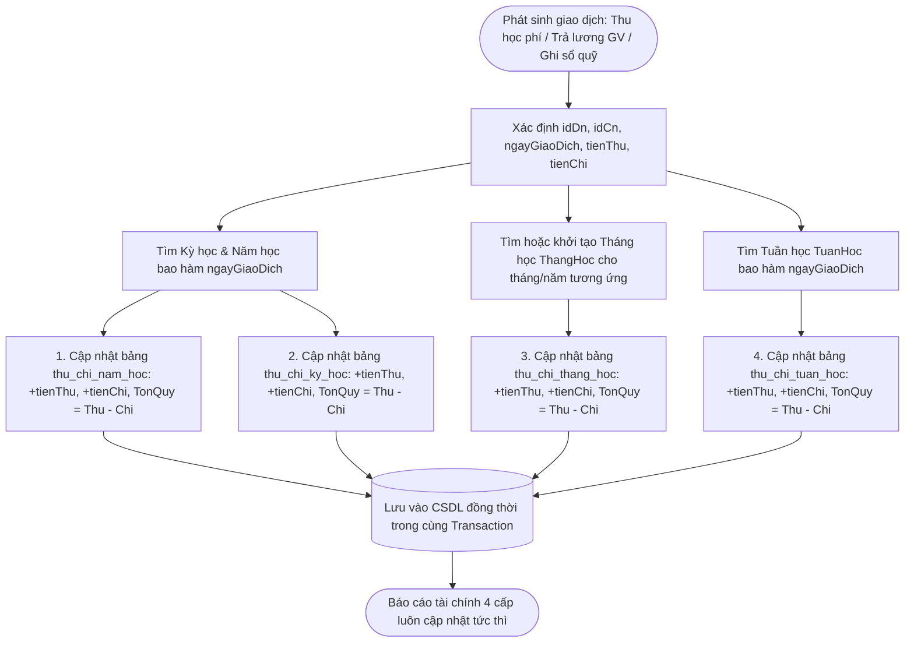
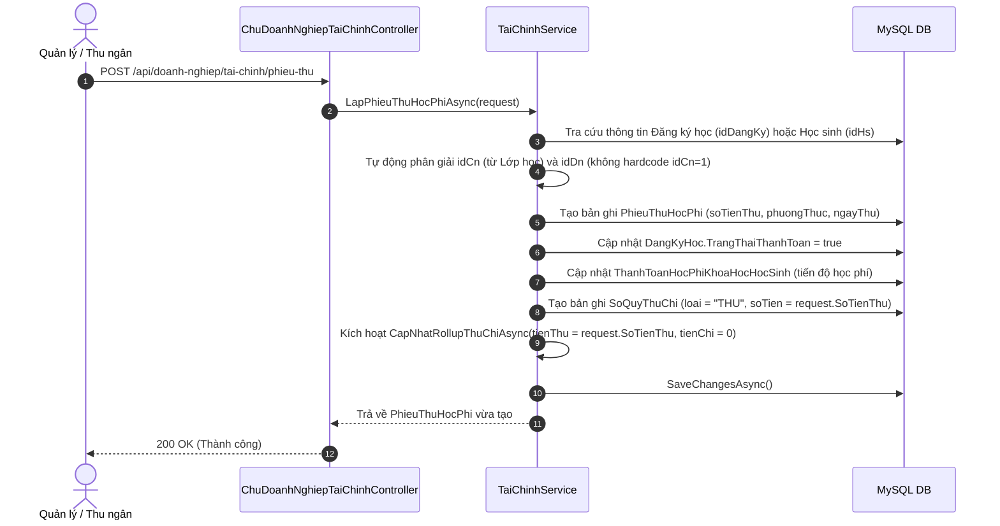
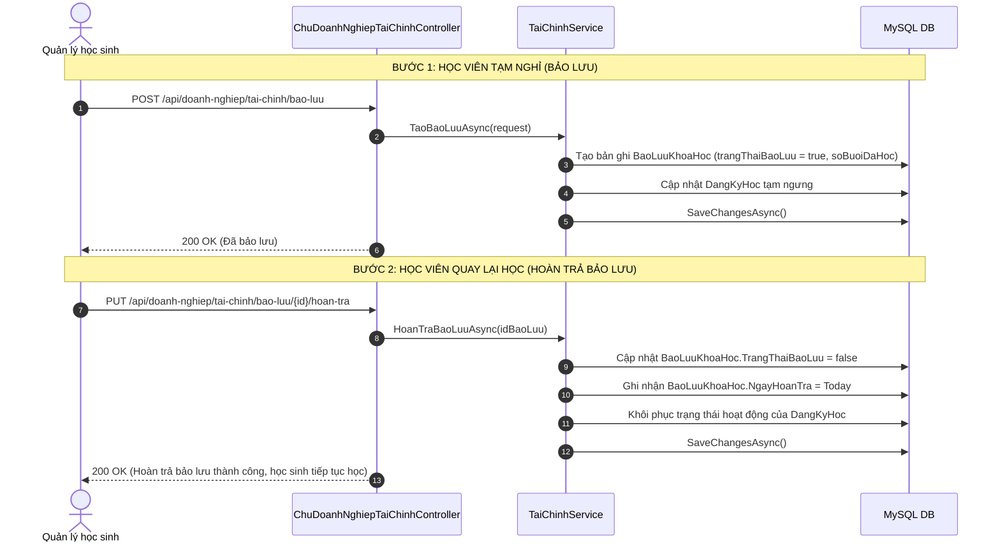

# BẢN ĐỒ NGHIỆP VỤ & THIẾT KẾ CƠ SỞ DỮ LIỆU: TÀI CHÍNH, HỌC PHÍ, LƯƠNG & ĐỘNG CƠ ROLLUP 4 CẤP
> **Module ID**: `08_TAI_CHINH_HOC_PHI_LUONG_ROLLUP`  
> **Service cốt lõi**: `ITaiChinhService` / `TaiChinhService.cs`  
> **Controllers phụ trách**: `ChuDoanhNghiepTaiChinhController.cs`, `QuanLyTaiChinhController.cs`, `GiaoVienTaiChinhController.cs`  
> **Trạng thái**: `[Đã hoàn thành - Đồng bộ 100% Java & .NET]`

---

## 1. TỔNG QUAN PHẠM VI NGHIỆP VỤ (MODULE OVERVIEW)

Module Tài chính quản lý dòng tiền toàn diện của doanh nghiệp giáo dục, đảm bảo tính chính xác và minh bạch giữa các cấp:
1. **Thu học phí**: Tiếp nhận học phí theo từng học sinh và khóa học; tự động kích hoạt trạng thái hoàn thành học phí trên hồ sơ đăng ký học (`dang_ky_hoc`); ghi nhận vào sổ quỹ.
2. **Chi trả lương & thù lao giáo viên**: Tính toán và thanh toán lương theo đúng chi nhánh công tác thực tế của giáo viên; tự động ghi nhận phiếu chi sổ quỹ; hỗ trợ hủy thanh toán hoàn tác dòng tiền.
3. **Bảo lưu & Hoàn trả bảo lưu**: Quản lý tạm dừng khóa học, bảo toàn số buổi đã học; quy trình hoàn trả bảo lưu khôi phục học sinh trở lại lớp học mà không làm thất thoát học phí.
4. **Sổ quỹ tiền mặt / ngân hàng (`so_quy_thu_chi`)**: Ghi nhận thời gian thực mọi khoản thu và chi có gắn mã chi nhánh (`id_cn`) và doanh nghiệp (`id_dn`).
5. **Động cơ Báo cáo Rollup 4 cấp (Real-time Financial Rollup Engine)**: Mỗi giao dịch Thu/Chi phát sinh sẽ tự động phân giải và cập nhật song song vào 4 bảng báo cáo chu kỳ: **Tuần học $\rightarrow$ Tháng học $\rightarrow$ Kỳ học $\rightarrow$ Năm học** với độ phức tạp $O(1)$.

---

## 2. SƠ ĐỒ THỰC THỂ CƠ SỞ DỮ LIỆU (DATABASE SCHEMA & ERD)

```mermaid
erDiagram
    DOANH_NGHIEP ||--o{ SO_QUY_THU_CHI : "sở hữu dòng tiền"
    CHI_NHANH ||--o{ SO_QUY_THU_CHI : "phát sinh tại"
    
    HOC_SINH ||--o{ PHIEU_THU_HOC_PHI : "nộp tiền"
    DANG_KY_HOC ||--o{ PHIEU_THU_HOC_PHI : "thanh toán cho"
    KHOA_HOC ||--o{ PHIEU_THU_HOC_PHI : "thu theo khóa"
    
    GIAO_VIEN ||--o{ THANH_TOAN_GIAO_VIEN : "nhận lương"
    KHOA_HOC ||--o{ THANH_TOAN_GIAO_VIEN : "thù lao khóa dạy"
    
    HOC_SINH ||--o{ BAO_LUU_KHOA_HOC : "yêu cầu bảo lưu"
    LOP_HOC ||--o{ BAO_LUU_KHOA_HOC : "tạm dừng tại lớp"
    DANG_KY_HOC ||--o{ BAO_LUU_KHOA_HOC : "bảo lưu suất học"
    
    CHI_NHANH ||--o{ THU_CHI_NAM_HOC : "báo cáo năm"
    NAM_HOC ||--o{ THU_CHI_NAM_HOC : "theo năm"
    
    CHI_NHANH ||--o{ THU_CHI_KY_HOC : "báo cáo kỳ"
    KY_HOC ||--o{ THU_CHI_KY_HOC : "theo kỳ"
    
    CHI_NHANH ||--o{ THU_CHI_THANG_HOC : "báo cáo tháng"
    THANG_HOC ||--o{ THU_CHI_THANG_HOC : "theo tháng"
    
    CHI_NHANH ||--o{ THU_CHI_TUAN_HOC : "báo cáo tuần"
    TUAN_HOC ||--o{ THU_CHI_TUAN_HOC : "theo tuần"

    SO_QUY_THU_CHI {
        int id_giao_dich PK "Auto Increment"
        int id_cn FK "Chi nhánh giao dịch"
        string loai_giao_dich "THU / CHI"
        decimal so_tien "Số tiền phát sinh"
        date ngay_giao_dich "Ngày thanh toán"
        string mo_ta "Ghi chú nội dung thu chi"
        int id_dn FK "Doanh nghiệp chủ quản"
        bool xoa "Soft delete flag"
    }

    PHIEU_THU_HOC_PHI {
        int id_phieu_thu PK "Auto Increment"
        int id_dang_ky FK "Đăng ký học"
        int id_hs FK "Học sinh nộp"
        int id_khoa_hoc FK "Khóa học"
        decimal so_tien_thu "Số tiền thu thực tế"
        date ngay_thu "Ngày lập phiếu thu"
        string phuong_thuc "TienMat / ChuyenKhoan"
        int id_dn FK "Doanh nghiệp"
        bool xoa "Soft delete flag"
    }

    THANH_TOAN_GIAO_VIEN {
        int id_thanh_toan PK "Auto Increment"
        int id_gv FK "Giáo viên nhận"
        int id_khoa_hoc FK "Khóa học giảng dạy"
        decimal so_tien_thanh_toan "Số tiền chi trả"
        date ngay_thanh_toan "Ngày chuyển lương"
        string ghi_chu "Chi tiết kỳ lương / giờ dạy"
        int id_dn FK "Doanh nghiệp"
        bool xoa "Soft delete flag"
    }

    BAO_LUU_KHOA_HOC {
        int id_bao_luu PK "Auto Increment"
        int id_hs FK "Học sinh bảo lưu"
        int id_lop FK "Lớp học bảo lưu"
        int id_dang_ky FK "Bản ghi đăng ký gốc"
        date ngay_bat_dau "Ngày bắt đầu bảo lưu"
        date ngay_ket_thuc "Hạn chót bảo lưu"
        int so_buoi_da_hoc "Số buổi đã hoàn thành trước khi nghỉ"
        bool trang_thai_bao_luu "true: Đang bảo lưu / false: Đã hoàn trả"
        date ngay_hoan_tra "Ngày học sinh quay lại học"
        int id_dn FK "Doanh nghiệp"
        bool xoa "Soft delete flag"
    }

    THU_CHI_NAM_HOC {
        int id_tc_nam PK "Auto Increment"
        int id_nam_hoc FK "Năm học"
        int id_cn FK "Chi nhánh"
        decimal tong_tien_thu "Tổng thu lũy kế năm"
        decimal tong_tien_chi "Tổng chi lũy kế năm"
        decimal ton_quy "Lợi nhuận ròng = Thu - Chi"
        int id_dn FK "Doanh nghiệp"
    }

    THU_CHI_KY_HOC {
        int id_tc_ky PK "Auto Increment"
        int id_ky_hoc FK "Kỳ học"
        int id_cn FK "Chi nhánh"
        decimal tong_tien_thu "Tổng thu lũy kế kỳ"
        decimal tong_tien_chi "Tổng chi lũy kế kỳ"
        decimal ton_quy "Lợi nhuận ròng kỳ"
        int id_dn FK "Doanh nghiệp"
    }

    THU_CHI_THANG_HOC {
        int id_tc_thang PK "Auto Increment"
        int id_thang_hoc FK "Tháng học"
        int id_cn FK "Chi nhánh"
        decimal tong_tien_thu "Tổng thu trong tháng"
        decimal tong_tien_chi "Tổng chi trong tháng"
        decimal ton_quy "Lợi nhuận ròng tháng"
        int id_dn FK "Doanh nghiệp"
    }

    THU_CHI_TUAN_HOC {
        int id_tc_tuan PK "Auto Increment"
        int id_tuan_hoc FK "Tuần học"
        int id_cn FK "Chi nhánh"
        decimal tong_tien_thu "Tổng thu trong tuần"
        decimal tong_tien_chi "Tổng chi trong tuần"
        decimal ton_quy "Lợi nhuận ròng tuần"
        int id_dn FK "Doanh nghiệp"
    }
```

---

## 3. CÁC LUỒNG NGHIỆP VỤ & THUẬT TOÁN SERVICE CHI TIẾT

### 3.1. Động cơ Rollup Báo cáo Thu Chi 4 cấp (O(1) Aggregation Engine)
Hàm thực thi: `CapNhatRollupThuChiAsync(int idDn, int idCn, DateOnly ngayGiaoDich, decimal tienThu, decimal tienChi, string? ghiChu)`

### 3.2. Luồng Lập phiếu thu học phí & Kích hoạt tiến độ học
Hàm thực thi: `LapPhieuThuHocPhiAsync(TaoPhieuThuRequest request)`

### 3.3. Luồng Bảo lưu & Hoàn trả bảo lưu học viên
Hàm thực thi: `TaoBaoLuuAsync` & `HoanTraBaoLuuAsync`

---

## 4. MA TRẬN API ENDPOINTS CỦA MODULE TÀI CHÍNH

| Endpoint | Method | Phân quyền (Roles) | Chức năng nghiệp vụ & Logic kiểm tra |
| :--- | :---: | :--- | :--- |
| `/api/doanh-nghiep/tai-chinh/phieu-thu` | `POST` | Admin, Chủ DN, Quản lý | Lập phiếu thu học phí, tự động phân giải `idCn`, bật `trang_thai_thanh_toan`, ghi sổ quỹ, kích hoạt Rollup THU. |
| `/api/hoc-sinh/{idHs}/phieu-thu` | `GET` | Mọi vai trò xác thực | Tra cứu toàn bộ lịch sử đóng học phí của một học sinh. |
| `/api/thanh-toan-luong` | `POST` | Admin, Chủ DN, Quản lý | Lập phiếu thanh toán lương giáo viên, tra cứu đúng chi nhánh công tác, ghi sổ quỹ CHI, kích hoạt Rollup CHI. |
| `/api/thanh-toan-giao-vien/{id}` | `DELETE` | Admin, Chủ DN | Hủy phiếu thanh toán lương, tự động cascade hủy `so_quy_thu_chi` và hoàn tác số tiền trong Rollup. |
| `/api/giao-vien/{idGv}/thanh-toan-luong` | `GET` | Giáo viên, Quản lý, Chủ DN | Tra cứu lịch sử thanh toán lương của giáo viên. |
| `/api/so-quy` | `GET` | Admin, Chủ DN, Quản lý | Xem sổ quỹ thu chi doanh nghiệp, hỗ trợ lọc theo chi nhánh và khoảng thời gian. |
| `/api/bao-luu` | `POST` | Admin, Chủ DN, Quản lý | Tạo phiếu bảo lưu khóa học, lưu số buổi đã học, tạm ngưng đăng ký học. |
| `/api/bao-luu/{id}/hoan-tra` | `PUT` | Admin, Chủ DN, Quản lý | Nghiệp vụ hoàn trả bảo lưu, khôi phục học sinh trở lại lớp, mở lại đăng ký học. |
| `/api/bao-luu/{id}` | `DELETE` | Admin, Chủ DN | Xóa phiếu bảo lưu khóa học (soft-delete). |
| `/api/thu-chi-nam/{idNamHoc}` | `GET` | Admin, Chủ DN, Quản lý | Truy vấn tức thì báo cáo thu chi, lợi nhuận cả năm (truy xuất O(1) từ bảng rollup). |
| `/api/thu-chi-ky/{idKyHoc}` | `GET` | Admin, Chủ DN, Quản lý | Báo cáo thu chi theo kỳ học. |
| `/api/thu-chi-thang/{idThangHoc}` | `GET` | Admin, Chủ DN, Quản lý | Báo cáo thu chi theo tháng học. |
| `/api/thu-chi-tuan/{idTuanHoc}` | `GET` | Admin, Chủ DN, Quản lý | Báo cáo thu chi theo tuần học. |
