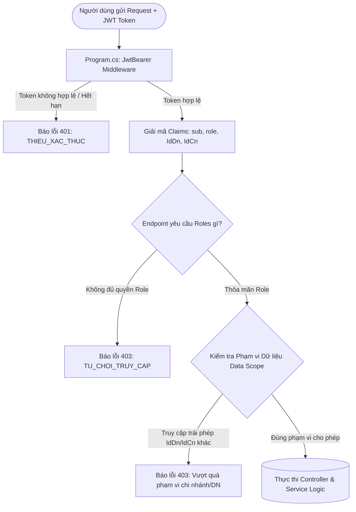
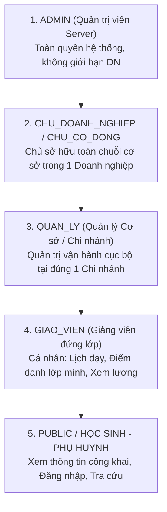

# BẢN ĐỒ NGHIỆP VỤ: MA TRẬN PHÂN QUYỀN HỆ THỐNG & ĐIỀU KHIỂN TRUY CẬP API (RBAC)
> **Tài liệu**: Ma trận Phân quyền & Điều khiển Truy cập API Toàn diện (Role-Based Access Control - RBAC)  
> **Mã Module**: `09_MA_TRAN_PHAN_QUYEN_RBAC_API`  
> **Phạm vi áp dụng**: Toàn bộ 31 REST Controllers, 9 Nhóm Services, Frontend Router & Token Validation  
> **Trạng thái**: `[Đã hoàn thành - Chuẩn hóa 100% .NET & Java Backend]`

---

## 1. TỔNG QUAN HỆ THỐNG PHÂN QUYỀN (RBAC ARCHITECTURE OVERVIEW)

Hệ thống quản trị trung tâm giáo dục được xây dựng trên mô hình **Kiểm soát Truy cập Dựa trên Vai trò (RBAC - Role-Based Access Control)** kết hợp **Cô lập Dữ liệu Đa tầng (Multi-tenant & Branch Scope Isolation)**:



### 1.1. Cấu trúc Claims trong JWT Access Token
Mỗi token cấp cho người dùng sau khi đăng nhập chứa các thông tin định danh:
- `sub` (`NameIdentifier`): Mã tài khoản `id_tk`.
- `role` / `roles`: Vai trò người dùng (`ADMIN`, `CHU_DOANH_NGHIEP`, `CHU_CO_DONG`, `QUAN_LY`, `GIAO_VIEN`).
- `roleId`: ID thực thể tương ứng (`id_admin`, `id_cd`, `id_qly`, `id_gv`).
- `idDoanhNghiep`: Mã doanh nghiệp mà người dùng trực thuộc (với `ADMIN` giá trị này là `null`/toàn quyền).
- `idChiNhanh`: Mã chi nhánh cơ sở mà người dùng công tác (áp dụng bắt buộc với `QUAN_LY`, giáo viên có thể dạy liên chi nhánh).
- `quyenHan`: Danh sách các permission codes chi tiết (ví dụ: `ALL_PERMISSIONS`, `ROLE_ADMIN`, ...).

---

## 2. PHÂN CẤP 5 NHÓM VAI TRÒ HỆ THỐNG (ROLE HIERARCHY)



### Mô tả quyền hạn từng vai trò:
1. **ADMIN (Quản trị viên Server)**:
   - Cấp quyền cao nhất, quản lý tài nguyên máy chủ.
   - Quản trị danh sách các doanh nghiệp, giải thể doanh nghiệp.
   - Quản trị các tài khoản Admin khác, giám sát và thu hồi token trên toàn hệ thống.
   - Có thể "đóng vai" hoặc truy xuất dữ liệu của bất kỳ doanh nghiệp nào bằng tham số `idDn`.
2. **CHU_DOANH_NGHIEP & CHU_CO_DONG (Chủ Doanh Nghiệp & Cổ Đông)**:
   - Toàn quyền quyết định trên phạm vi Doanh nghiệp sở hữu (`id_dn`):
   - Mở chi nhánh mới, bổ nhiệm quản lý chi nhánh, quản lý cổ phần & góp vốn.
   - Toàn quyền trên các mảng: Nhân sự (tuyển dụng, import hàng loạt, sa thải), Đào tạo (mở lớp, TKB, khóa học), Học sinh (tiếp nhận, duyệt bảo lưu), Tài chính (xem sổ quỹ, rollup 4 cấp, bảng lương toàn chuỗi).
3. **QUAN_LY (Quản lý Chi Nhánh / Cơ Sở)**:
   - Điều hành hoạt động tại chi nhánh được bổ nhiệm (`id_cn`):
   - Xem dashboard vận hành chi nhánh (số lớp mở, học sinh, ca học hôm nay).
   - Quản lý phòng học, sắp xếp lớp học, phân công giáo viên tại cơ sở.
   - Lập phiếu thu học phí, tiếp nhận đơn bảo lưu của học sinh cơ sở.
   - Giám sát điểm danh học sinh và chấm công giáo viên đứng lớp.
   - *Giới hạn*: Không xem được số liệu doanh nghiệp khác, không xóa được doanh nghiệp, không can thiệp vốn cổ đông.
4. **GIAO_VIEN (Giáo viên giảng dạy)**:
   - Quản lý công việc cá nhân: Xem lịch dạy tuần, xem danh sách học sinh các lớp mình dạy.
   - Thực hiện điểm danh học sinh các buổi dạy của mình.
   - Cập nhật hồ sơ cá nhân, tải lên/xóa chứng chỉ của bản thân (nghiêm cấm can thiệp giáo viên khác).
   - Xem bảng thanh toán lương/thù lao cá nhân.
5. **PUBLIC / VÃNG LAI**:
   - Truy cập các API công khai: Đăng nhập (`/api/auth/login`), Làm mới token (`/api/auth/refresh-token`), Đa ngôn ngữ, Tìm kiếm số điện thoại/CCCD công khai.

---

## 3. MA TRẬN PHÂN QUYỀN TRUY CẬP CHI TIẾT TỪNG API ENDPOINT

### Bảng chú giải ký hiệu:
- ✅ **Toàn quyền**: Được phép gọi API và thao tác đầy đủ.
- 🟡 **Giới hạn phạm vi**: Được phép gọi nhưng bị lọc dữ liệu theo `IdDn` hoặc `IdCn` hoặc quyền sở hữu cá nhân (`Own`).
- ❌ **Từ chối (403 Forbidden)**: Hoàn toàn không được phép truy cập.

---

### PHẦN I: HỆ THỐNG SERVER, BẢO MẬT & TÀI KHOẢN

| Endpoint | Method | Chức năng nghiệp vụ | ADMIN | CHỦ DN | QUẢN LÝ | GIÁO VIÊN | PUBLIC |
| :--- | :---: | :--- | :---: | :---: | :---: | :---: | :---: |
| `/api/auth/login` | `POST` | Đăng nhập hệ thống & Cấp JWT | ✅ | ✅ | ✅ | ✅ | ✅ |
| `/api/auth/refresh-token` | `POST` | Làm mới Access Token | ✅ | ✅ | ✅ | ✅ | ✅ |
| `/api/auth/doi-mat-khau` | `POST` | Đổi mật khẩu tài khoản cá nhân | ✅ (Own) | ✅ (Own) | ✅ (Own) | ✅ (Own) | ❌ |
| `/api/admin/quan-tri-vien` | `GET/POST` | Quản lý danh sách Admin Server | ✅ | ❌ | ❌ | ❌ | ❌ |
| `/api/admin/quan-tri-vien/{id}` | `PUT/DELETE`| Sửa/Xóa Admin Server | ✅ | ❌ | ❌ | ❌ | ❌ |
| `/api/admin/tokens` | `GET` | Xem tất cả phiên đăng nhập hệ thống | ✅ | ❌ | ❌ | ❌ | ❌ |
| `/api/admin/tokens/{id}/revoke`| `DELETE` | Thu hồi cưỡng chế token người dùng | ✅ | ❌ | ❌ | ❌ | ❌ |
| `/api/admin/server/thong-ke` | `GET` | Thống kê số lượng toàn hệ thống | ✅ | ❌ | ❌ | ❌ | ❌ |

---

### PHẦN II: DOANH NGHIỆP, CỔ ĐÔNG & CHI NHÁNH

| Endpoint | Method | Chức năng nghiệp vụ | ADMIN | CHỦ DN | QUẢN LÝ | GIÁO VIÊN | PUBLIC |
| :--- | :---: | :--- | :---: | :---: | :---: | :---: | :---: |
| `/api/admin/doanh-nghiep` | `GET/POST` | Xem toàn bộ / Tạo mới Doanh nghiệp | ✅ | ❌ | ❌ | ❌ | ❌ |
| `/api/admin/doanh-nghiep/{id}` | `DELETE` | Giải thể DN & Cascade khóa nhân sự | ✅ | ❌ | ❌ | ❌ | ❌ |
| `/api/doanh-nghiep/{idDn}/chi-nhanh`| `GET` | Danh sách chi nhánh cơ sở | ✅ | ✅ (Own DN)| 🟡 (Own CN)| 🟡 (Own CN)| ❌ |
| `/api/doanh-nghiep/{idDn}/chi-nhanh`| `POST` | Khởi tạo chi nhánh cơ sở mới | ✅ | ✅ (Own DN)| ❌ | ❌ | ❌ |
| `/api/chi-nhanh/{idCn}` | `PUT/DELETE`| Sửa thông tin / Xóa chi nhánh | ✅ | ✅ (Own DN)| ❌ | ❌ | ❌ |
| `/api/doanh-nghiep/{idDn}/co-dong` | `GET/POST` | Quản lý cổ đông sáng lập | ✅ | ✅ (Own DN)| ❌ | ❌ | ❌ |
| `/api/doanh-nghiep/gop-von` | `POST` | Ghi nhận tiền góp vốn cổ phần | ✅ | ✅ (Own DN)| ❌ | ❌ | ❌ |
| `/api/doanh-nghiep/quan-ly` | `POST` | Bổ nhiệm Quản lý chi nhánh | ✅ | ✅ (Own DN)| ❌ | ❌ | ❌ |
| `/api/quan-ly/{idQly}` | `DELETE` | Miễn nhiệm Quản lý cơ sở | ✅ | ✅ (Own DN)| ❌ | ❌ | ❌ |

---

### PHẦN III: NHÂN SỰ & GIÁO VIÊN

| Endpoint | Method | Chức năng nghiệp vụ | ADMIN | CHỦ DN | QUẢN LÝ | GIÁO VIÊN | PUBLIC |
| :--- | :---: | :--- | :---: | :---: | :---: | :---: | :---: |
| `/api/doanh-nghiep/nhan-su/teachers`| `GET` | Xem danh sách giáo viên có lọc | ✅ | ✅ (Own DN)| 🟡 (Own CN)| ❌ | ❌ |
| `/api/doanh-nghiep/giao-vien` | `POST` | Tạo mới 1 giáo viên | ✅ | ✅ (Own DN)| 🟡 (Own CN)| ❌ | ❌ |
| `/api/doanh-nghiep/nhan-su/teachers/bulk`| `POST`| **Import giáo viên hàng loạt (max 50)** | ✅ | ✅ (Own DN)| 🟡 (Own CN)| ❌ | ❌ |
| `/api/doanh-nghiep/giao-vien/{id}` | `PUT/DELETE`| Cập nhật / Xóa mềm giáo viên | ✅ | ✅ (Own DN)| 🟡 (Own CN)| ❌ | ❌ |
| `/api/giao-vien/ho-so/me` | `GET/PUT` | Xem & sửa hồ sơ cá nhân giáo viên | ❌ | ❌ | ❌ | ✅ (Own) | ❌ |
| `/api/giao-vien/{idGv}/chung-chi` | `GET` | Xem danh sách chứng chỉ văn bằng | ✅ | ✅ (Own DN)| 🟡 (Own CN)| ✅ (Own) | ❌ |
| `/api/giao-vien/ho-so/chung-chi` | `POST` | Upload chứng chỉ văn bằng cá nhân | ❌ | ❌ | ❌ | ✅ (Own) | ❌ |
| `/api/giao-vien/ho-so/chung-chi/{id}`| `DELETE`| Xóa chứng chỉ cá nhân | ❌ | ❌ | ❌ | ✅ (Own) | ❌ |
| `/api/doanh-nghiep/nhan-cong` | `GET/POST` | Quản lý nhân sự hỗ trợ (bảo vệ, tạp vụ)| ✅ | ✅ (Own DN)| 🟡 (Own CN)| ❌ | ❌ |

---

### PHẦN IV: HỌC SINH, PHỤ HUYNH & ĐĂNG KÝ HỌC

| Endpoint | Method | Chức năng nghiệp vụ | ADMIN | CHỦ DN | QUẢN LÝ | GIÁO VIÊN | PUBLIC |
| :--- | :---: | :--- | :---: | :---: | :---: | :---: | :---: |
| `/api/doanh-nghiep/hoc-sinh` | `GET` | Danh sách học sinh phân trang | ✅ | ✅ (Own DN)| 🟡 (Own CN)| ❌ | ❌ |
| `/api/hoc-sinh/{id}` | `GET` | Xem hồ sơ 360 học sinh | ✅ | ✅ (Own DN)| 🟡 (Own CN)| 🟡 (Lớp dạy)| ❌ |
| `/api/doanh-nghiep/hoc-sinh` | `POST` | Tiếp nhận học sinh mới (chống trùng CCCD)| ✅ | ✅ (Own DN)| 🟡 (Own CN)| ❌ | ❌ |
| `/api/doanh-nghiep/hoc-sinh/{id}` | `PUT/DELETE`| Cập nhật hồ sơ / Xóa học sinh | ✅ | ✅ (Own DN)| 🟡 (Own CN)| ❌ | ❌ |
| `/api/hoc-sinh/{idHs}/phu-huynh` | `GET/POST` | Quản lý phụ huynh của học sinh | ✅ | ✅ (Own DN)| 🟡 (Own CN)| ❌ | ❌ |
| `/api/phu-huynh-hoc-sinh/{id}` | `DELETE` | Xóa liên kết phụ huynh - học sinh | ✅ | ✅ (Own DN)| 🟡 (Own CN)| ❌ | ❌ |
| `/api/doanh-nghiep/hoc-sinh-khoa-hoc`| `POST` | Gán học sinh vào khóa (Sync DangKyHoc)| ✅ | ✅ (Own DN)| 🟡 (Own CN)| ❌ | ❌ |
| `/api/doanh-nghiep/hoc-sinh-khoa-hoc/{idHs}/{idKh}`| `DELETE`| Xóa học sinh khỏi khóa (Cascade xóa ĐK)| ✅ | ✅ (Own DN)| 🟡 (Own CN)| ❌ | ❌ |

---

### PHẦN V: ĐÀO TẠO, LỚP HỌC & THỜI KHÓA BIỂU

| Endpoint | Method | Chức năng nghiệp vụ | ADMIN | CHỦ DN | QUẢN LÝ | GIÁO VIÊN | PUBLIC |
| :--- | :---: | :--- | :---: | :---: | :---: | :---: | :---: |
| `/api/dao-tao/lop-hoc` | `GET` | Xem danh sách lớp học | ✅ | ✅ (Own DN)| 🟡 (Own CN)| 🟡 (Lớp dạy)| ❌ |
| `/api/dao-tao/lop-hoc` | `POST/PUT` | Mở lớp học mới / Cập nhật lớp | ✅ | ✅ (Own DN)| 🟡 (Own CN)| ❌ | ❌ |
| `/api/dao-tao/lop-hoc/{id}` | `DELETE` | Xóa lớp học | ✅ | ✅ (Own DN)| ❌ | ❌ | ❌ |
| `/api/dao-tao/lop-hoc/{id}/phan-cong-giao-vien/{idGv}`| `PUT`| Phân công giáo viên chủ nhiệm | ✅ | ✅ (Own DN)| 🟡 (Own CN)| ❌ | ❌ |
| `/api/dao-tao/thoi-khoa-bieu/tuan` | `POST` | Xếp TKB tuần (Chống trùng 3 lớp) | ✅ | ✅ (Own DN)| 🟡 (Own CN)| ❌ | ❌ |
| `/api/dao-tao/thoi-khoa-bieu/tuan/hang-loat`| `POST`| Lưu TKB hàng loạt | ✅ | ✅ (Own DN)| 🟡 (Own CN)| ❌ | ❌ |
| `/api/doanh-nghiep/dao-tao/lop-hoc/{idLop}/sinh-buoi-hoc-tuan/{idTuan}`| `POST`| Tự động sinh buổi học từ TKB | ✅ | ✅ (Own DN)| 🟡 (Own CN)| ❌ | ❌ |
| `/api/giao-vien/thoi-khoa-bieu` | `GET` | Giáo viên xem lịch dạy tuần của mình | ❌ | ❌ | ❌ | ✅ (Own) | ❌ |
| `/api/dao-tao/dang-ky-hoc` | `POST` | Đăng ký học viên vào lớp | ✅ | ✅ (Own DN)| 🟡 (Own CN)| ❌ | ❌ |
| `/api/dao-tao/dang-ky-hoc/{id}/huy` | `PUT` | Hủy đăng ký học | ✅ | ✅ (Own DN)| 🟡 (Own CN)| ❌ | ❌ |

---

### PHẦN VI: ĐIỂM DANH BUỔI HỌC

| Endpoint | Method | Chức năng nghiệp vụ | ADMIN | CHỦ DN | QUẢN LÝ | GIÁO VIÊN | PUBLIC |
| :--- | :---: | :--- | :---: | :---: | :---: | :---: | :---: |
| `/api/diem-danh/buoi-hoc/{idBuoiHoc}`| `GET` | Xem danh sách điểm danh buổi học | ✅ | ✅ (Own DN)| 🟡 (Own CN)| 🟡 (Buổi dạy)| ❌ |
| `/api/buoi-hoc/{idBuoiHoc}/diem-danh-hoc-sinh`| `POST`| **Lưu điểm danh batch & bù vắng mặt** | ✅ | ✅ (Own DN)| 🟡 (Own CN)| 🟡 (Buổi dạy)| ❌ |
| `/api/khoa-hoc/{idKhoaHoc}/diem-danh-hoc-sinh`| `GET`| Tra cứu chuyên cần khóa học | ✅ | ✅ (Own DN)| 🟡 (Own CN)| 🟡 (Lớp dạy)| ❌ |
| `/api/buoi-hoc/{idBuoiHoc}/diem-danh-giao-vien`| `POST`| Chấm công ca dạy của giáo viên | ✅ | ✅ (Own DN)| 🟡 (Own CN)| ❌ | ❌ |
| `/api/giao-vien/{idGv}/lich-su-diem-danh`| `GET`| Lịch sử ca dạy giáo viên | ✅ | ✅ (Own DN)| 🟡 (Own CN)| ✅ (Own) | ❌ |

---

### PHẦN VII: TÀI CHÍNH, HỌC PHÍ, LƯƠNG & ROLLUP 4 CẤP

| Endpoint | Method | Chức năng nghiệp vụ | ADMIN | CHỦ DN | QUẢN LÝ | GIÁO VIÊN | PUBLIC |
| :--- | :---: | :--- | :---: | :---: | :---: | :---: | :---: |
| `/api/doanh-nghiep/tai-chinh/phieu-thu`| `POST`| Lập phiếu thu học phí (Kích hoạt Rollup)| ✅ | ✅ (Own DN)| 🟡 (Own CN)| ❌ | ❌ |
| `/api/hoc-sinh/{idHs}/phieu-thu` | `GET` | Lịch sử nộp tiền học sinh | ✅ | ✅ (Own DN)| 🟡 (Own CN)| ❌ | ❌ |
| `/api/thanh-toan-luong` | `POST`| Trả lương GV (Rollup chi phí lương) | ✅ | ✅ (Own DN)| 🟡 (Own CN)| ❌ | ❌ |
| `/api/thanh-toan-giao-vien/{id}`| `DELETE`| Hủy phiếu lương (Hoàn tác sổ quỹ) | ✅ | ✅ (Own DN)| ❌ | ❌ | ❌ |
| `/api/giao-vien/{idGv}/thanh-toan-luong`| `GET`| Xem bảng thanh toán lương cá nhân | ✅ | ✅ (Own DN)| 🟡 (Own CN)| ✅ (Own) | ❌ |
| `/api/so-quy` | `GET` | Sổ quỹ thu chi tiền mặt | ✅ | ✅ (Own DN)| 🟡 (Own CN)| ❌ | ❌ |
| `/api/bao-luu` | `POST`| Lập đơn bảo lưu (Tạm dừng lớp học) | ✅ | ✅ (Own DN)| 🟡 (Own CN)| ❌ | ❌ |
| `/api/bao-luu/{id}/hoan-tra` | `PUT` | **Hoàn trả bảo lưu (Khôi phục lớp học)**| ✅ | ✅ (Own DN)| 🟡 (Own CN)| ❌ | ❌ |
| `/api/thu-chi-nam/{idNamHoc}` | `GET` | Báo cáo Thu - Chi - Lợi nhuận Năm | ✅ | ✅ (Own DN)| 🟡 (Own CN)| ❌ | ❌ |
| `/api/thu-chi-ky/{idKyHoc}` | `GET` | Báo cáo Thu - Chi Kỳ học | ✅ | ✅ (Own DN)| 🟡 (Own CN)| ❌ | ❌ |
| `/api/thu-chi-thang/{idThangHoc}`| `GET`| Báo cáo Thu - Chi Tháng học | ✅ | ✅ (Own DN)| 🟡 (Own CN)| ❌ | ❌ |
| `/api/thu-chi-tuan/{idTuanHoc}` | `GET` | Báo cáo Thu - Chi Tuần học | ✅ | ✅ (Own DN)| 🟡 (Own CN)| ❌ | ❌ |

---

## 4. QUY TẮC CÔ LẬP DỮ LIỆU ĐA TẦNG (DATA SCOPE ISOLATION RULES)

Ngoài việc kiểm tra quyền truy cập ở cấp Endpoint Controller qua `[Authorize(Roles = "...")]`, tầng Service của hệ thống bắt buộc áp dụng **3 quy tắc cô lập dữ liệu**:

1. **Quy tắc Cô lập Doanh nghiệp (Enterprise Isolation)**:
   - Tất cả các truy vấn dữ liệu từ Chủ Doanh Nghiệp, Quản lý, Giáo viên đều tự động được áp dụng bộ lọc `WHERE id_dn = @CurrentEnterpriseId`.
   - Người dùng ở Doanh nghiệp A tuyệt đối không thể xem hoặc chỉnh sửa dữ liệu của Doanh nghiệp B, kể cả khi biết chính xác ID bản ghi.
2. **Quy tắc Giới hạn Chi nhánh (Branch Scope Boundary)**:
   - Với tài khoản có vai trò `QUAN_LY`, hệ thống tự động gán cứng `targetCnId = claim.IdChiNhanh`.
   - Mọi thao tác lập phiếu thu, xếp TKB, mở lớp học chỉ có hiệu lực trên chi nhánh của Quản lý đó.
3. **Quy tắc Sở hữu Cá nhân (Self-Ownership Enforcement)**:
   - Với vai trò `GIAO_VIEN`, các thao tác chỉnh sửa hồ sơ, thêm chứng chỉ, xem bảng lương bắt buộc phải thỏa mãn:
     ```csharp
     int currentGvId = LayIdGiaoVienDangNhap();
     if (requestedGvId != currentGvId)
     {
         return ApiResponse<T>.Forbidden("Bạn không có quyền thao tác trên hồ sơ của giáo viên khác.");
     }
     ```

---

## 5. MÃ PHẢN HỒI LỖI BẢO MẬT CHUẨN HÓA

Khi có vi phạm phân quyền hoặc thiếu thông tin xác thực, hệ thống luôn trả về JSON chuẩn theo hợp đồng `ApiResponse<T>`:

### 5.1. Khi thiếu hoặc sai Token (HTTP 401 Unauthorized)
```json
{
  "success": false,
  "statusCode": 401,
  "code": "THIEU_XAC_THUC",
  "message": "Yêu cầu xác thực. Vui lòng cung cấp JWT Token hợp lệ.",
  "data": null,
  "errors": ["Unauthorized"]
}
```

### 5.2. Khi không đủ thẩm quyền vai trò (HTTP 403 Forbidden)
```json
{
  "success": false,
  "statusCode": 403,
  "code": "TU_CHOI_TRUY_CAP",
  "message": "Bạn không có quyền hạn thực hiện thao tác này.",
  "data": null,
  "errors": ["Forbidden"]
}
```
